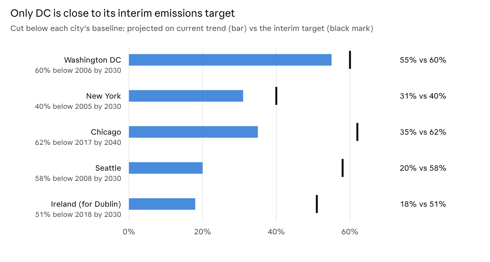
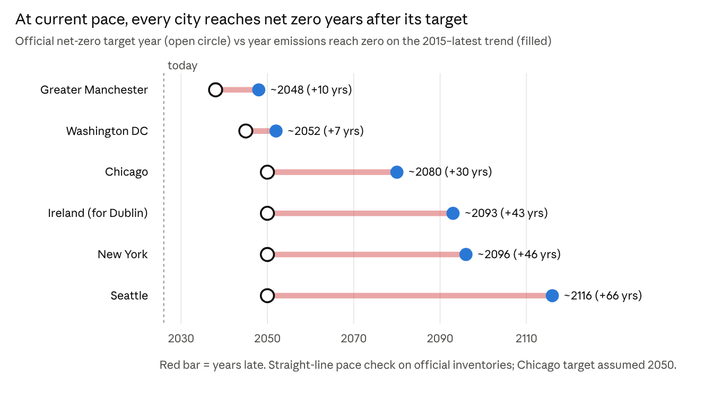
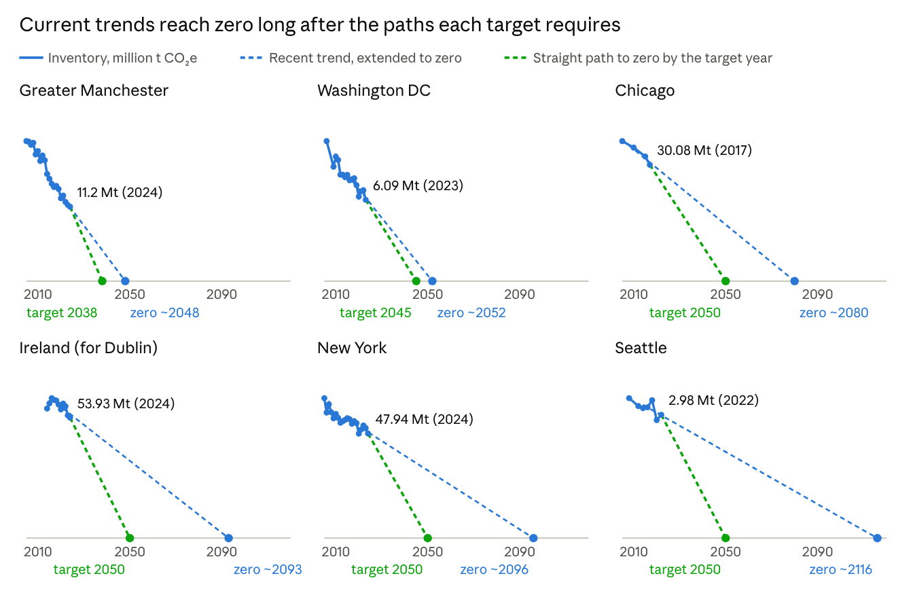
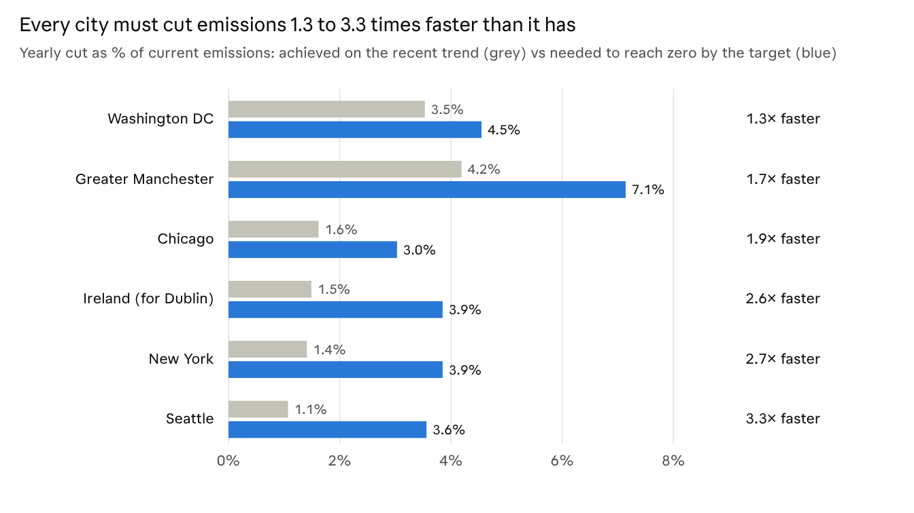
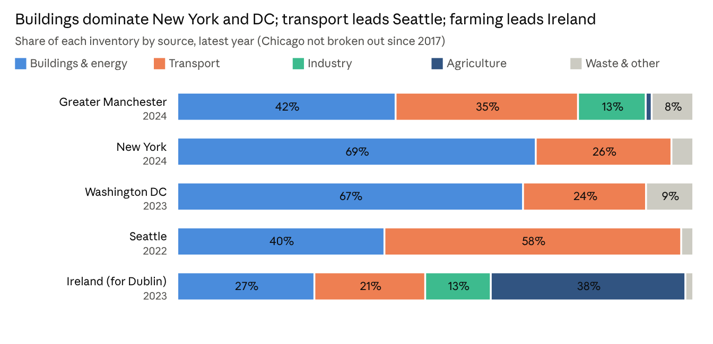
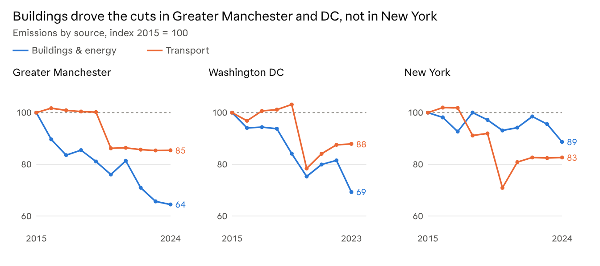

# Six-City Net-Zero Data Plan

As of 11 November 2026 · Seattle, Greater Manchester, Chicago, New York City, Washington DC, Dublin

Companion to [`REPORT.md`](REPORT.md). Emissions data behind every chart: [`climate.csv`](climate.csv). Charts: [`charts/net-zero/`](charts/net-zero/).

## The answer

At the pace of the last decade, none of the six cities reaches net-zero emissions by its own target year. Greater Manchester (around 2048) and Washington DC (around 2052) are closest. New York, Chicago and Ireland (for Dublin) would take until the 2080s or 2090s, and Seattle's core emissions are falling slowly enough to push past 2100. To hit their targets, every city would need to cut emissions roughly 1.3 to 3.3 times faster than it has since 2015.

| City | Official net-zero target | Year emissions reach zero on current trend | Gap |
| --- | --- | --- | --- |
| Greater Manchester | 2038 | ~2048 | ~10 years late |
| Washington DC | 2045 | ~2052 | ~7 years late |
| Chicago | 2050 (working assumption) | ~2080 | ~30 years late |
| Ireland, national (for Dublin) | 2050 | ~2093 | ~43 years late |
| New York | 2050 | ~2096 | ~46 years late |
| Seattle | 2050 | after 2100 (~2116) | 60+ years late |

"Fully climate controlled" here means net-zero greenhouse-gas emissions: each city's remaining emissions brought to zero or balanced by removals. The projection draws a straight line through each city's official inventory since 2015 (Seattle since 2014, Chicago 2005–2017) and finds where it crosses zero. It is a pace check, not a forecast: new policy, a cleaner grid or an economic shock would change it.

## Targets against the trend

Only Washington DC is close to its interim target; the rest are well short of the milestones that sit on the way to net zero.

| City | Interim target | Where the trend puts it | Net-zero target | Source |
| --- | --- | --- | --- | --- |
| Greater Manchester | Carbon budget path in the Five-Year Environment Plan 2025–2030 | 11.2 Mt in 2024, falling 0.47 Mt a year | Carbon neutral by 2038 | [GMCA Five-Year Environment Plan](https://www.greatermanchester-ca.gov.uk/media/alnl0fsy/gmca_5-year-plan_final_digital_v3-ua.pdf) |
| Washington DC | 60% below 2006 by 2030 (4.20 Mt) | 55% below in 2030 (4.75 Mt) | Carbon neutral by 2045 | [DOEE GHG inventories](https://doee.dc.gov/service/greenhouse-gas-inventories) |
| New York | 40% below 2005 by 2030 (38.5 Mt) | 31% below in 2030 (44.5 Mt) | Carbon neutral by 2050 | [Local Law 97](https://www.nyc.gov/site/buildings/codes/ll97-greenhouse-gas-emissions-reductions.page); [NYC City Record](https://www.nyc.gov/assets/dcas/downloads/pdf/cityrecord/2019/cityrecord-09-26-19.pdf) |
| Seattle | 58% below 2008 by 2030 (core) | about 20% below in 2030 | Carbon neutral by 2050 | [Seattle resolution](https://www.seattle.gov/documents/departments/council/members/obrien/ose-paris-agreement-res_v8.pdf) |
| Chicago | 62% reduction by 2040 | about 35% below 2017 in 2040 | 2050 (working assumption; not stated on the plan's page) | [2022 Chicago Climate Action Plan](https://www.chicago.gov/city/en/sites/climate-action-plan/home.html) |
| Dublin (Ireland) | 51% below 2018 by 2030 | about 18% below in 2030 (national) | Climate neutral by 2050 | [Dublin City Council CAP 2024–2029](https://www.dublincity.ie/sites/default/files/2024-06/final-cap-2024-2029.pdf); [Ireland Climate Action Plan 2024](https://assets.gov.ie/static/documents/climate-action-plan-2024-8ccbde73-e288-4241-8b26-6b4922389f25.pdf) |

*Trend-projected cut in the interim target year vs each city's stated interim goal · inventories in climate.csv*

Chicago's 2040 comparison assumes a 2017 baseline, the year of its latest public inventory. Dublin's comparison uses Ireland's national inventory because Dublin publishes no annual city total; Ireland's 51% goal applies nationally and the city plan adopts it.

## Projection

*Projected from city inventories in climate.csv · targets from each city's climate plan*

The gap between the open and filled circles is the delay at today's pace. Greater Manchester and DC are within about a decade of their goals; the cities with flatter trends, or where cuts have stalled since the pandemic rebound, slide far past 2050.

The evidence behind those dates, city by city. In each panel the green path is what the target requires from today; the dashed blue trend shows where the last decade's pace actually leads. Greater Manchester's and DC's two lines nearly overlap, while New York's, Ireland's and Seattle's run almost flat by comparison.

*City inventories (DESNZ, DOEE, City of Chicago, Eurostat, NYC MOCEJ, Seattle OSE) · trend = least-squares line over the fit window*

## What it would take

Each city has to roughly double its annual cut on average, and the hardest-to-move sector differs: buildings in New York and DC, road transport in Seattle and Greater Manchester, agriculture nationally in Ireland.

*Achieved = trend slope over latest emissions; needed = latest emissions spread evenly over the years left to the target*

What each city's emissions are made of decides which levers matter most:

*DESNZ 2024 (Greater Manchester), NYC inventory 2024, DOEE 2023, Seattle OSE 2022 core, EPA Ireland 2023 national · electricity counted with buildings*

The levers that moved emissions in the last decade will not finish the job on their own:

- **Cleaner electricity** drove most of the cuts in Greater Manchester and DC. Seattle's power is already mostly hydro, which is why its trend is flattest: it has no coal left to retire.
- **Building heat** is the next big block. Gas boilers and furnaces have to be replaced with heat pumps or district heat, which is what New York's Local Law 97 and DC's Building Energy Performance Standards force for large buildings.
- **Road transport** fell only 12–15% in Greater Manchester and DC since 2015, against 31–36% for buildings and energy. New York is the exception: its buildings fell least (chart below). Getting transport down means electric vehicles plus fewer car miles (transit, cycling, land use).
- **Dublin's** own city emissions are mostly buildings and transport, like the other cities; agriculture dominates only the national total used here as a stand-in.

*DESNZ sector totals (Greater Manchester), DOEE workbook (DC), NYC GHG inventory · index 2015 = 100*

The split matters for the forecast. Where a cleaner grid did the work (Greater Manchester, DC), buildings fell by about a third and transport is now the slow part. In New York, buildings and energy fell only 11% since 2015, which is why Local Law 97's building caps carry most of the city's plan.

## The data plan

Track one headline number a year and a handful of leading indicators every month or quarter, so a city drifting off course shows up within months instead of when its inventory lands one to three years later.

| Indicator | Why it matters | US sources (Seattle, Chicago, NYC, DC) | UK source (Greater Manchester) | Ireland source (Dublin) | Update |
| --- | --- | --- | --- | --- | --- |
| Total GHG emissions (headline) | The net-zero measure itself | City inventories (OSE, Chicago DOE, MOCEJ, DOEE) | DESNZ local authority GHG statistics | EPA Ireland inventory; Codema city baselines | Yearly, 1–3 year lag |
| Grid carbon intensity (g CO₂/kWh) | Biggest past driver of cuts | EIA and EPA eGRID | NESO Carbon Intensity API | EirGrid system data | Monthly |
| Building gas use | Proxy for heating emissions | Utility and state energy data | DESNZ sub-national gas consumption | Gas Networks Ireland; SEAI | Yearly (monthly where utilities publish) |
| Large-building energy benchmarking | Tracks building performance laws | Seattle, Chicago, NYC LL84 and DC benchmarking open data | Display Energy Certificates | SEAI Building Energy Ratings | Yearly |
| Heat pumps and electrification permits | Shows heat moving off gas | City building permits | MCS installation data | SEAI grant statistics | Quarterly |
| Vehicle miles and fuel sales | Road transport, the stubborn sector | FHWA highway statistics; state fuel tax data | DfT road traffic statistics | TII traffic counters; CSO fuel sales | Yearly / monthly |
| Electric share of new cars | Leading signal for transport | State vehicle registrations | DfT vehicle licensing tables | SIMI registrations | Monthly |
| Transit ridership | Car miles avoided | National Transit Database | DfT bus and light rail statistics | National Transport Authority | Monthly |
| Temperature, CO₂ and air quality | The outcome in the atmosphere | NOAA; EPA AirData | Met Office; DEFRA AURN | Met Éireann; EPA Ireland | Yearly (daily raw) |

Gaps to close first:

1. **Chicago** has no public citywide inventory after 2017. Request the 2019–2024 figures from the Department of Environment or build an estimate from utility, benchmarking and traffic data.
2. **Dublin** has a single 2016 baseline. Ask Codema and the four councils for later years, and use national sector shares only as a stopgap.
3. **Seattle** publishes every two years. Fill the odd years from Seattle City Light, Puget Sound Energy and traffic data.
4. **Scope differences.** Report every city on the same basis (the GPC "basic" inventory: buildings, transport, waste) alongside its own headline figure.

How this fits the Mandate repository:

1. Add a **Climate** category with metrics for total emissions, emissions per resident, grid intensity, gas use and electric-car share, imported through the existing CSV pipeline.
2. Load the data already compiled in `imports/research/city-comparison-2026-11/climate.csv` as the first rows.
3. Publish a yearly scorecard each autumn: each city's latest inventory, trend line, projected net-zero year and the gap to its target, using the method in this plan.
4. Re-run the projection in 2030 against each interim target (DC 60%, New York 40%, Seattle 58%, Dublin 51%) and record whether each was met.

## Method, caveats and sources

The projection fits a least-squares straight line to each city's annual inventory totals and extends it to zero. Fit windows: 2015–2024 for Greater Manchester, New York and Ireland; 2015–2023 for DC; 2014–2022 for Seattle (biennial core inventory); 2005–2017 for Chicago (four inventory years). The needed rate is the latest total divided by the years left to the target. Speed-up is needed rate over achieved rate.

Caveats:

- **A straight line is a pace check, not a forecast.** Real paths curve: early cuts (coal) are cheaper than late ones (heat, freight, aviation), and net zero usually allows a small residual balanced by removals.
- **The 2020 pandemic dip** sits inside every fit and flatters the trend slightly.
- **Different inventory scopes.** Greater Manchester counts all territorial sectors; Seattle counts core sectors only; Ireland's national total includes agriculture, which Dublin's city emissions barely do.
- **Stale data.** Chicago's latest public total is 2017 and Dublin's city figure is 2016, so their lines are the least certain.
- **Chicago's net-zero year** of 2050 is a working assumption; the city's plan page states only the 62% by 2040 goal.

Data: inventory totals compiled in [`climate.csv`](climate.csv), from [DESNZ UK local authority GHG statistics](https://www.gov.uk/government/statistics/uk-local-authority-and-regional-greenhouse-gas-emissions-statistics-2005-to-2024), [NYC Greenhouse Gas Emissions Inventory](https://data.cityofnewyork.us/d/wq7q-htne), [DC DOEE inventories](https://doee.dc.gov/service/greenhouse-gas-inventories), [Seattle 2022 Community GHG Inventory](https://www.seattle.gov/documents/Departments/OSE/2022%20GHG%20Inventory%20Report%20-%20Final%2012-13-24%20%281%29.pdf), the City of Chicago 2017 GHG Inventory Report, Eurostat env_air_gge and [Codema Dublin baselines](https://www.codema.ie/our-work/baseline-emission-inventories-dublin-region/). Sector shares and trends also use the DC DOEE 2006–2023 inventory workbook and EPA Ireland's 2022–2023 sector table. Targets: sources linked in the targets table above, plus [Ireland's climate bill announcement](https://www.gov.ie/en/department-of-climate-energy-and-the-environment/press-releases/government-approves-landmark-climate-bill-putting-ireland-on-the-path-to-net-zero-emissions-by-2050/).
