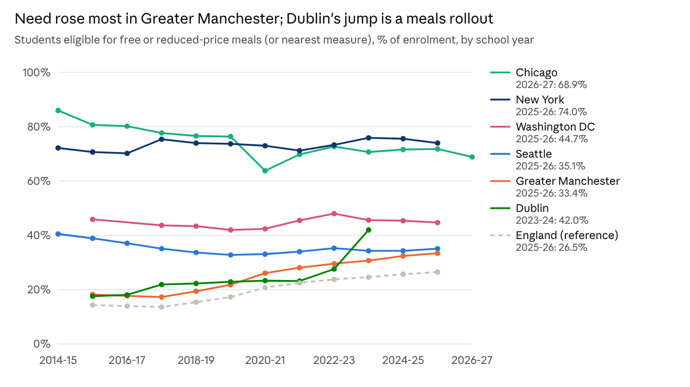
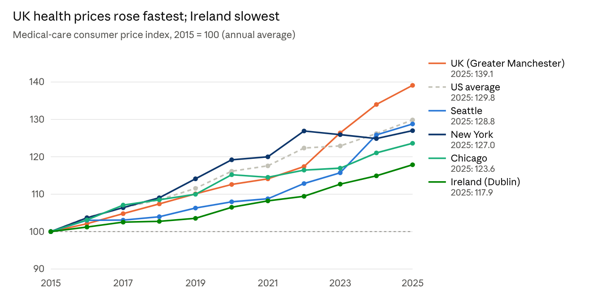
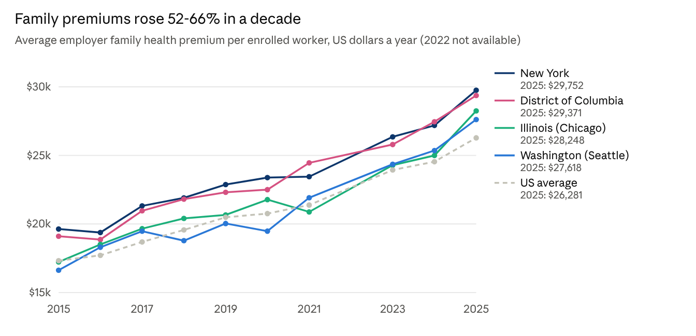
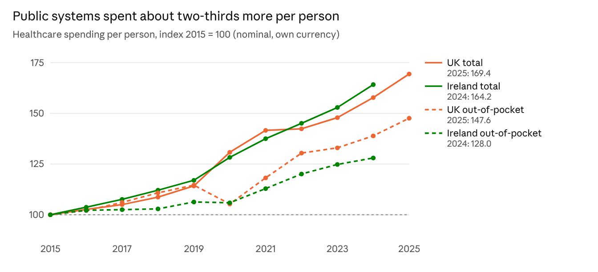
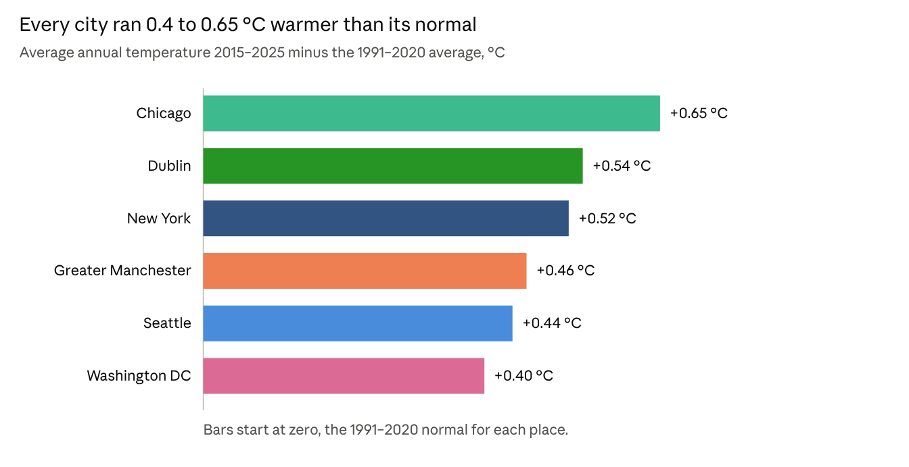
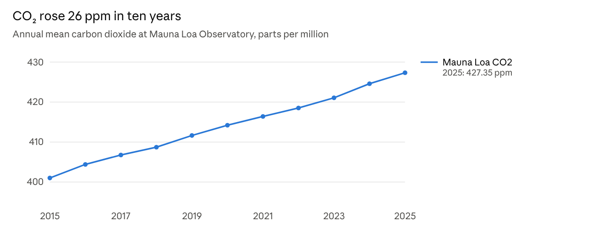
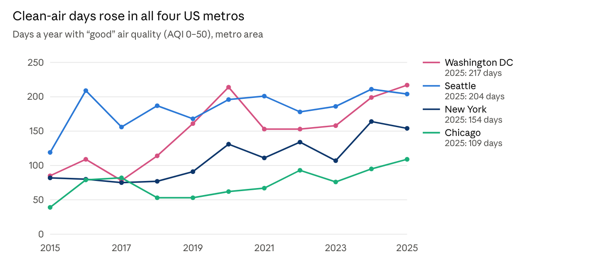
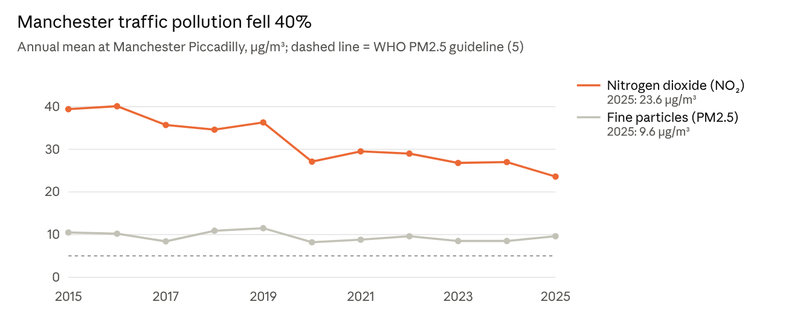
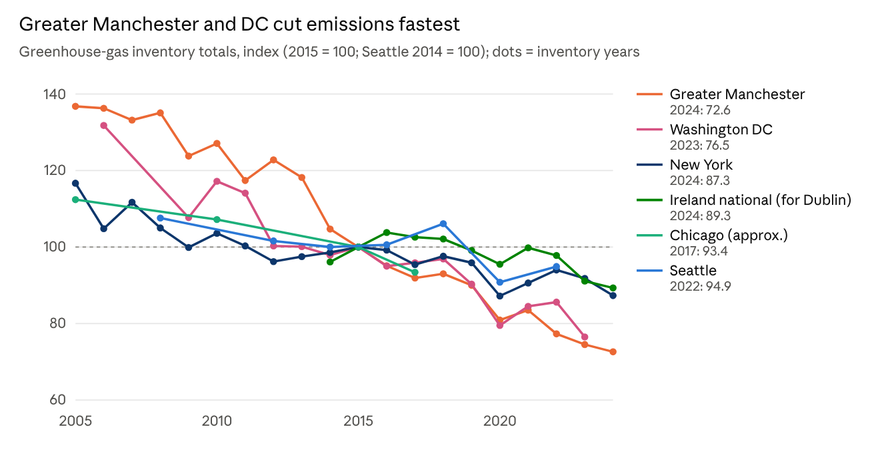

# Six-City Lunch, Health & Climate Report

As of 10 November 2026 · Seattle, Greater Manchester, Chicago, New York City, Washington DC, Dublin · 2015–2025

All nine charts on one page: [`charts/all-charts.png`](charts/all-charts.png). Data behind every chart: the CSV files in this folder. Interactive version: [Six-City Lunch, Health & Climate Ledger](https://claude.ai/artifact/Y3x79ZtczM8gCdpygXHuBn).

## Summary

Over 2015–2025, Greater Manchester saw the sharpest rise in child need, employer health insurance in the US rose 52–66%, and every city ran warmer while cutting measured emissions. This report compares Seattle, Greater Manchester, Chicago, New York City, Washington DC and Dublin on three questions, using government statistical releases and each city's own published inventories.

| Question | Headline finding |
| --- | --- |
| 1. Students on free or reduced-price meals | Greater Manchester rose from 18.2% to 33.4% of pupils (+15.2 points). Chicago fell from 80.7% to 68.9%; New York (74.0%), Seattle (35.1%) and DC (44.7%) moved a few points. Dublin's state-funded meal coverage rose from 17.6% to 42.0% through policy expansion. |
| 2. Cost of healthcare | Medical prices rose 24–29% in the US metros, 39% in the UK and 18% in Ireland. Employer family premiums rose 52% (New York) to 66% (Washington State). UK spending per person rose 69%; Ireland's 64%. |
| 3. Climate change | CO₂ at Mauna Loa rose from 401 to 427 ppm. Each city's 2015–2025 average ran 0.40–0.65 °C above its 1991–2020 normal. Inventory emissions fell 27% in Greater Manchester, 23% in DC, 13% in New York, about 7% in Chicago and 5% in Seattle; Ireland's national total fell 11%. |

Measures are not identical across the US, UK and Ireland. Each section says where they differ, and the last section lists every source.

## 1. Students on free or reduced-price meals

Greater Manchester's share of pupils eligible for free school meals rose from 18.2% to 33.4% between 2015-16 and 2025-26, the largest rise in need of any city here. The three biggest US districts still have higher shares, but theirs held steady or fell.

*Sources: DfE, OSPI, NYC DOE, Chicago Public Schools, OSSE, Ireland Dept of Social Protection + CSO · school years 2014-15 to 2026-27*

Each line uses the closest official measure each school system publishes, so levels are not directly comparable across countries; trends within each line are.

| Place | Measure used | Change, 2015-16 to latest | Source |
| --- | --- | --- | --- |
| Greater Manchester (10 boroughs) | Free school meals eligible, state-funded schools | +15.2 points (to 2025-26) | DfE, Schools, pupils and their characteristics |
| England (reference) | Free school meals eligible | +12.2 points (to 2025-26) | DfE |
| Seattle Public Schools | Low-income (free or reduced-price meal eligible) | −3.9 points (to 2025-26) | OSPI Report Card Enrollment |
| Chicago Public Schools | Free/reduced-price lunch, later "economically disadvantaged" | −11.8 points (to 2026-27) | CPS 20th-day demographics reports |
| New York City public schools | Poverty: free/reduced-price eligible or HRA benefits | +3.3 points (to 2025-26) | NYC DOE Demographic Snapshot |
| Washington DC public schools | At-risk: TANF/SNAP, homeless, foster care, over-age | −1.2 points (to 2025-26) | OSSE enrollment audit |
| Dublin (Ireland, national) | Pupils served a School Meals Programme meal | +24.4 points (to 2023-24) | Dept of Social Protection; CSO enrolments |

What to know when reading the chart:

- **England has no reduced-price tier.** Free-school-meal eligibility is a stricter, benefits-based test, so Greater Manchester's level sits below US rates even though its rise is real. Universal Credit transitional protection, which keeps pupils eligible once they qualify, also pushed the England-wide rate up.
- **New York's 2017-18 step** comes from a broader poverty definition (adding families receiving HRA benefits), not a sudden change in need.
- **Chicago's 2020-21 dip** reflects pandemic disruption to eligibility paperwork.
- **DC** serves free meals to every student, so the federal lunch figure there is a flat placeholder (76.4% each year). OSSE's at-risk share is used instead; 2016-17 was not published in that form.
- **Dublin** has no individual means test and no city count. Its line shows the national share of pupils actually served, which jumped in 2023-24 when hot meals reached 900 more primary schools. About 682,000 children are in eligible schools from 2025-26.

Within Greater Manchester, need rose in every borough, and Manchester itself now has close to half of pupils eligible.

| Borough | 2015/16 | 2025/26 | Change (points) |
| --- | --- | --- | --- |
| Manchester | 27.5% | 49.0% | +21.4 |
| Salford | 21.6% | 37.4% | +15.8 |
| Tameside | 18.4% | 36.3% | +17.9 |
| Oldham | 18.2% | 35.6% | +17.4 |
| Rochdale | 19.1% | 33.5% | +14.3 |
| Wigan | 14.2% | 29.6% | +15.4 |
| Bolton | 16.3% | 29.1% | +12.8 |
| Bury | 15.0% | 25.8% | +10.9 |
| Stockport | 13.7% | 22.8% | +9.0 |
| Trafford | 9.3% | 17.4% | +8.1 |

## 2. Cost of healthcare

The price of medical care rose 24–29% in the three US metros, 39% in the UK and 18% in Ireland from 2015 to 2025. What American families pay for insurance rose much faster: employer family premiums climbed 52–66%.

### Prices of medical care

*Sources: BLS CPI-U via FRED (CUURA423SAM, CUURA207SAM, CUURA101SAM, CPIMEDNS), ONS D7BZ, CSO CPA01 · annual averages 2015–2025*

In every US metro, medical prices rose more slowly than prices overall; only the UK saw health prices outpace general inflation. The US medical index understates what households pay for insurance, because it measures insurers' retained earnings rather than premiums. BLS stopped publishing a medical-care index for the Washington DC area after its 2018 area redesign, so DC appears through premiums only.

| Area | Medical care, 2015→2025 | All items, 2015→2025 | Gap (points) |
| --- | --- | --- | --- |
| UK (Greater Manchester) | +39.1% | +38.4% | +0.7 |
| US average | +29.8% | +35.8% | −6.0 |
| Seattle metro | +28.8% | +45.2% | −16.5 |
| New York metro | +27.0% | +32.6% | −5.6 |
| Chicago metro | +23.6% | +32.2% | −8.6 |
| Ireland (Dublin) | +17.9% | +24.2% | −6.4 |

### Employer health insurance (US)

*Sources: AHRQ MEPS-IC Table II.D.1 (2015–2020); MEPS-IC via KFF State Health Facts (2021, 2023–2025)*

The premium covers both the employer's and the worker's share. Washington State and Illinois rose fastest, and their workers' own family contributions roughly doubled.

| State | Premium change, 2015→2025 | After US inflation | Worker's family contribution, 2015→2025 |
| --- | --- | --- | --- |
| Washington (Seattle) | +66.1% | +22.3% | $4,265 → $8,222 (+93%) |
| Illinois (Chicago) | +64.0% | +20.7% | $3,890 → $7,838 (+101%) |
| District of Columbia | +53.7% | +13.2% | $5,120 → $8,028 (+57%) |
| New York | +51.6% | +11.6% | $5,190 → $7,075 (+36%) |
| US average | +51.7% | +11.7% | $4,710 → $7,314 (+55%) |

### Spending in tax-funded systems (UK and Ireland)

*Sources: ONS UK Health Accounts Table 1c (2025 provisional); Eurostat hlth_sha11_hf for Ireland (to 2024)*

In the UK and Ireland most care is publicly funded, so cost shows up as public spending per person rather than premiums. Both rose about two-thirds in nominal terms, with a step up during the pandemic. Out-of-pocket costs (prescriptions, dentistry, opticians and, in Ireland, GP fees) grew more slowly.

| Spending per person | 2015 | Latest | Change |
| --- | --- | --- | --- |
| UK, all healthcare | £2,931 | £4,966 (2025, provisional) | +69.4% |
| UK, government-financed | £2,306 | £4,036 (2025) | +75.0% |
| UK, out of pocket | £473 | £698 (2025) | +47.6% |
| Ireland, all healthcare | €4,097 | €6,728 (2024) | +64.2% |
| Ireland, government-financed | €2,947 | €5,229 (2024) | +77.4% |
| Ireland, out of pocket | €557 | €713 (2024) | +28.0% |

There is no Greater Manchester-only or Dublin-only price index; national figures apply. NHS Greater Manchester receives £2,065 per registered patient for core services in 2025/26, against an England average of £1,975, because the needs-based formula gives more to areas with higher deprivation.

## 3. Climate change

The atmosphere over every city warmed and carried more CO₂, while each city's own emissions accounting shows emissions falling. Atmospheric measurement shows the global problem arriving locally; emissions accounting shows each city's contribution to it.

### Atmospheric measurement: temperature

*Sources: NOAA NCEI Climate at a Glance and Global Summary of the Month; Met Office HadUK-Grid · annual means, normal 1991–2020*

All six places warmed by roughly 0.2 °C per decade over their full records. Single years swing with weather, so the decade average is the signal.

| Place (station) | Normal 1991–2020 | Average 2015–2025 | Trend per decade | Record since |
| --- | --- | --- | --- | --- |
| Chicago (O'Hare) | 10.77 °C | 11.42 °C | +0.19 °C | 1959 (2012 missing) |
| Dublin (Phoenix Park) | 10.13 °C | 10.68 °C | +0.20 °C | 1950 (2006–08, 2010–12 missing) |
| New York (Central Park) | 13.20 °C | 13.72 °C | +0.24 °C | 1950 |
| Greater Manchester (NW England regional series) | 9.21 °C | 9.67 °C | +0.21 °C | 1950 |
| Seattle (Sea-Tac) | 11.42 °C | 11.86 °C | +0.25 °C | 1950 |
| Washington DC (Reagan National) | 15.35 °C | 15.75 °C | +0.19 °C | 1950 |

### Atmospheric measurement: carbon dioxide

*Source: NOAA Global Monitoring Laboratory, Mauna Loa annual means · 2015–2025*

CO₂ mixes evenly around the globe, so NOAA's baseline record at Mauna Loa stands for all six cities. It rose from 401.0 to 427.4 parts per million, about 2.6 ppm a year.

### Atmospheric measurement: air quality

*Source: EPA AirData, annual AQI by metro area (CBSA) · 2015–2025*

Good-air days rose in all four US metros as power plants and vehicles got cleaner. Wildfire smoke now drives the worst days: Chicago had 43 days above AQI 100 in 2023, during the Canadian fires, against 15 the year before.

*Source: DEFRA Automatic Urban and Rural Network, site MAN3, annual means of hourly data · 2015–2025*

In Manchester, traffic-related nitrogen dioxide fell 40%. Fine particles barely moved and stay above the WHO guideline. Dublin shows the same pattern by EPA Ireland's account: traffic NO₂ is falling (St John's Road West last breached the EU annual limit in 2019), while winter PM2.5 from solid-fuel heating keeps Dublin above WHO guidelines. EPA Ireland publishes these trends only as chart images, so Dublin is not plotted.

### Emissions accounting

*Sources: DESNZ local authority GHG statistics; NYC GHG Inventory; DC DOEE inventory; Seattle OSE 2022 inventory; City of Chicago 2017 report; Eurostat env_air_gge*

Indexing puts inventories of very different size and scope on one scale. Seattle publishes every two years, and Chicago's newest public citywide inventory is for 2017. Dublin has no annual city inventory, so Ireland's national total stands in for it.

| Place | Inventory basis | Base year | Then (Mt CO₂e) | Latest | Now (Mt CO₂e) | Change |
| --- | --- | --- | --- | --- | --- | --- |
| Greater Manchester | Territorial, all sectors (DESNZ) | 2015 | 15.43 | 2024 | 11.20 | −27.4% |
| Washington DC | Citywide sector inventory (DOEE) | 2015 | 7.96 | 2023 | 6.09 | −23.5% |
| New York | Citywide GPC inventory | 2015 | 54.94 | 2024 | 47.94 | −12.7% |
| Ireland, national (for Dublin) | National total excl. land use | 2015 | 60.36 | 2024 | 53.93 | −10.7% |
| Chicago | City inventory, approximate tonnes | 2015 | 32.22 | 2017 | 30.08 | −6.6% |
| Seattle | Core sectors, before offsets | 2014 | 3.14 | 2022 | 2.98 | −5.1% |

Per resident, Greater Manchester fell from 5.60 to 3.72 tonnes (2015–2024) and Seattle from 5.44 to 3.85 tonnes (2008–2022, net core). Dublin's only area-wide inventory, Codema's 2016 baseline, put the four Dublin council areas at 7.80 Mt and Dublin City at 2.81 Mt, or 5.1 tonnes per resident.

What drove the changes:

- **Greater Manchester**: homes, commerce and industry cut emissions as the UK grid dropped coal; transport was flat until 2020 and has stayed about 15% lower since.
- **Washington DC**: DOEE credits greener regional electricity and more efficient commercial buildings for most of its cut.
- **New York**: buildings still produce about two-thirds of citywide emissions.
- **Seattle**: its electricity is mostly hydropower, so road transport dominates (about 58%) and fell only during the pandemic.
- **All cities**: these are territorial inventories. Consumption-based accounting, which counts goods and services residents buy, is far larger; Seattle estimates about 16 t CO₂e per resident on that basis.

## Methods, caveats and sources

Every figure comes from a government statistical release or a city's own published inventory, read directly from the source file where one was available. Derived figures (shares, indexes, percentage changes, temperature averages) were computed from those files, and the compiled data sit in this folder (`school_meals.csv`, `gm_boroughs_fsm.csv`, `health_costs.csv`, `climate.csv`).

Caveats that affect how to read the numbers:

- **Comparability.** Meal-eligibility measures differ by country and district; price indexes are each country's own; emissions inventories differ in scope. Compare trends, not levels, across countries.
- **Approximations.** Chicago's tonnages apply the city's published percentage cuts (−11.0% in 2015, −16.9% in 2017) to its 36.2 Mt 2005 baseline. Seattle's yearly totals are summed from its official appendix tables.
- **National figures standing in for cities.** UK prices and spending apply to Greater Manchester; Irish prices, spending, school meals and emissions apply to Dublin.
- **Gaps.** No DC medical-care price index after 2017; no 2022 state premium table; no Chicago citywide inventory after 2017; no annual Dublin inventory; Dublin air-quality trends published only as images.
- **Provisional data.** UK health spending for 2025 and the latest EPA air-quality year are provisional and may be revised.

Sources:

- School meals: [DfE, Schools, pupils and their characteristics](https://explore-education-statistics.service.gov.uk/find-statistics/school-pupils-and-their-characteristics); [OSPI Report Card Enrollment (data.wa.gov)](https://data.wa.gov/); [NYC DOE Demographic Snapshot](https://infohub.nyced.org/reports/students-and-schools/school-quality/information-and-data-overview); [Chicago Public Schools demographics](https://www.cps.edu/about/district-data/demographics/); [OSSE enrollment audit](https://osse.dc.gov/page/2024-25-school-year-enrollment-audit-report-and-data); [Ireland Dept of Social Protection, Analytical Paper on the School Meals Programme](https://assets.gov.ie/static/documents/Analytical_Paper_on_the_School_Meals_Programme.pdf); [Dáil written answer, 28 May 2025](https://www.oireachtas.ie/ga/debates/question/2025-05-28/section/264/); CSO tables EDA42 and EDA72.
- Healthcare: BLS CPI-U via FRED (CUURA423SAM, CUURA207SAM, CUURA101SAM, CPIMEDNS and matching all-items series); [AHRQ MEPS-IC state tables](https://meps.ahrq.gov/data_stats/summ_tables/insr/state/series_2/2020/tiid1.htm); [KFF State Health Facts, family premiums (MEPS-IC)](https://www.kff.org/private-insurance/state-indicator/family-coverage/); [ONS CPI health (D7BZ)](https://www.ons.gov.uk/economy/inflationandpriceindices/timeseries/d7bz/mm23); [ONS UK Health Accounts](https://www.ons.gov.uk/peoplepopulationandcommunity/healthandsocialcare/healthcaresystem/bulletins/ukhealthaccounts/2024and2025); CSO CPI table CPA01; Eurostat hlth_sha11_hf; [House of Commons Library CBP-10031](https://researchbriefings.files.parliament.uk/documents/CBP-10031/CBP-10031.pdf).
- Climate: [NOAA NCEI Climate at a Glance](https://www.ncei.noaa.gov/access/monitoring/climate-at-a-glance/); NOAA Global Summary of the Month (Dublin Phoenix Park, EI000003969); [Met Office HadUK-Grid regional series](https://www.metoffice.gov.uk/research/climate/maps-and-data/uk-and-regional-series); [NOAA GML Mauna Loa CO₂](https://gml.noaa.gov/ccgg/trends/); [EPA AirData annual AQI](https://aqs.epa.gov/aqsweb/airdata/download_files.html); DEFRA AURN site MAN3; [EPA Ireland, Air Quality in Ireland 2025](https://www.epa.ie/publications/monitoring--assessment/air/Air-Quality-in-Ireland-2025-FLAT.pdf).
- Emissions: [DESNZ UK local authority GHG statistics 2005–2024](https://www.gov.uk/government/statistics/uk-local-authority-and-regional-greenhouse-gas-emissions-statistics-2005-to-2024); [NYC Greenhouse Gas Emissions Inventory](https://data.cityofnewyork.us/d/wq7q-htne); [DC DOEE GHG inventories](https://doee.dc.gov/service/greenhouse-gas-inventories); [Seattle 2022 Community GHG Inventory](https://www.seattle.gov/documents/Departments/OSE/2022%20GHG%20Inventory%20Report%20-%20Final%2012-13-24%20%281%29.pdf); [City of Chicago 2017 GHG Inventory Report](https://www.chicago.gov/content/dam/city/progs/env/GHG_Inventory/Chicago-2017-GHG-Report_Final.pdf); [Codema Dublin baseline inventories](https://www.codema.ie/our-work/baseline-emission-inventories-dublin-region/); Eurostat env_air_gge.
