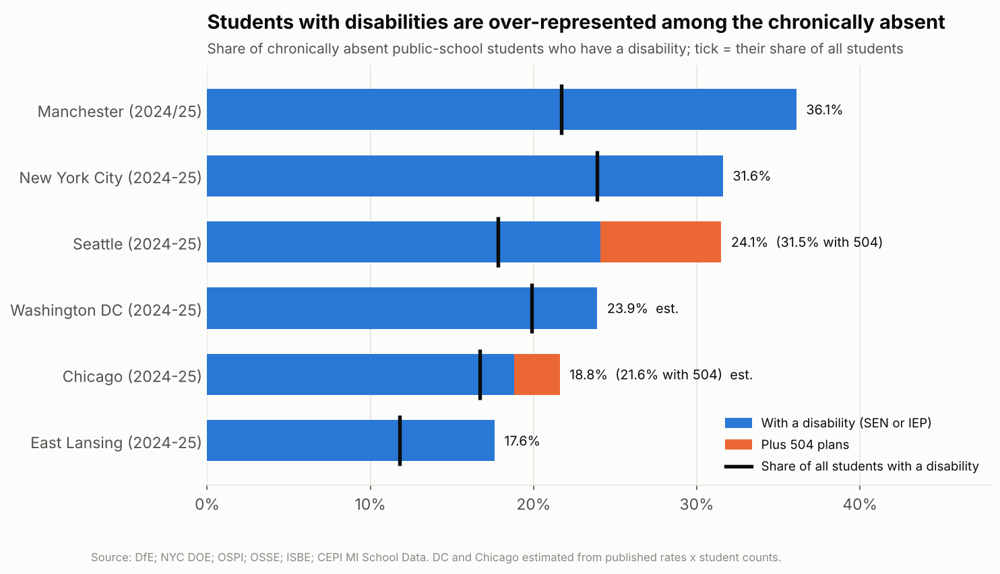
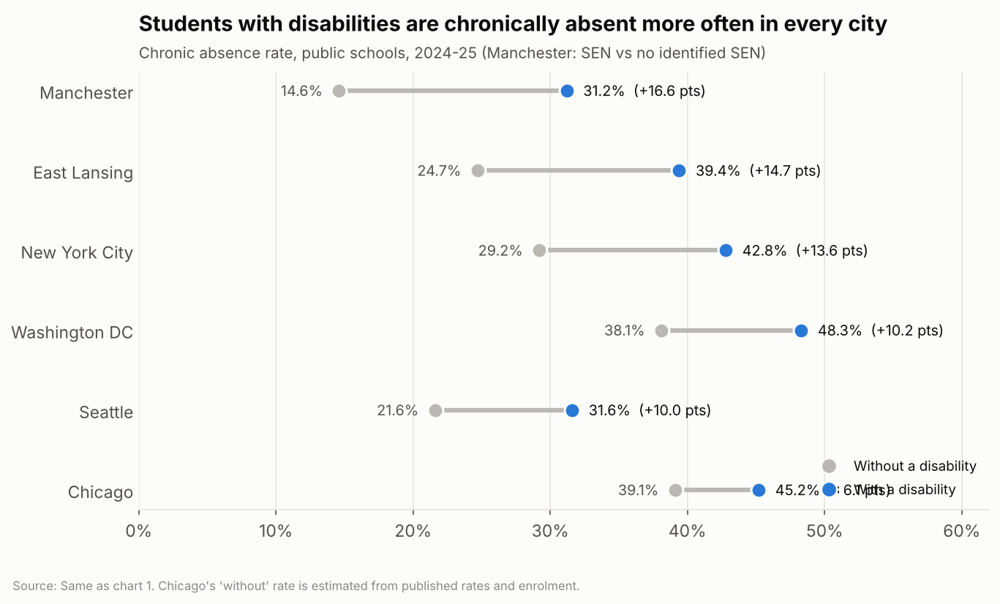
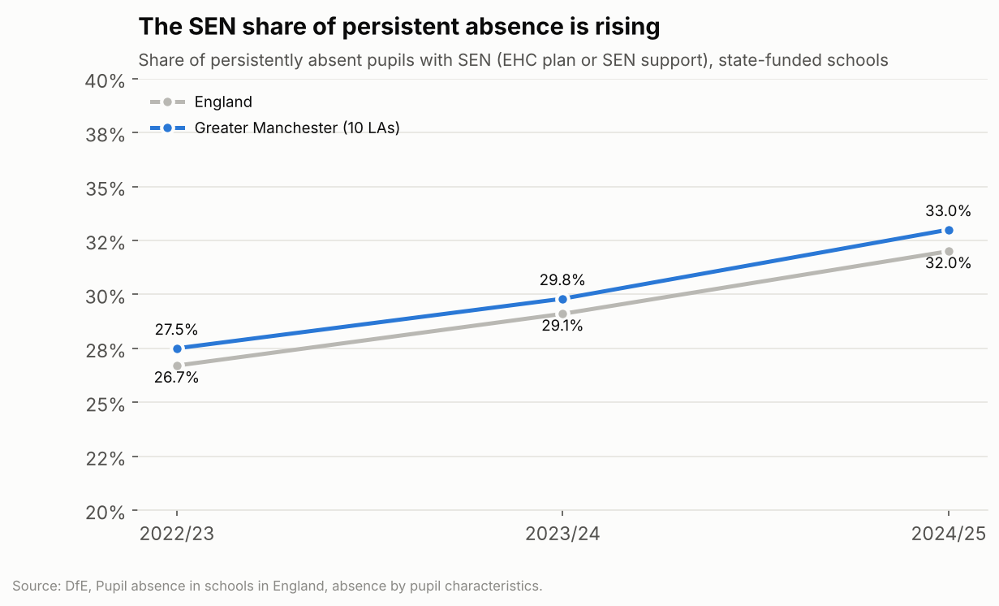
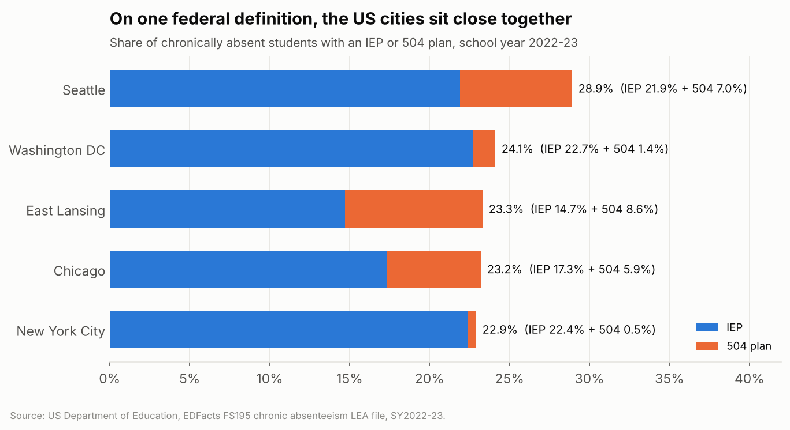
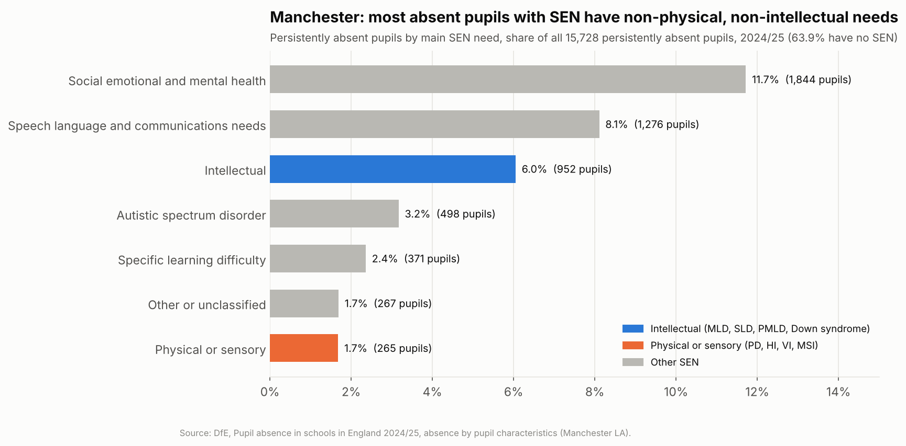
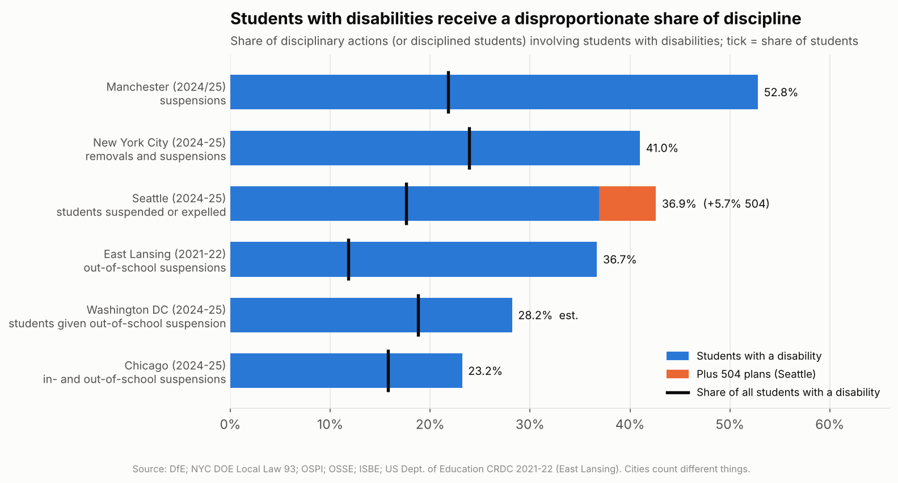
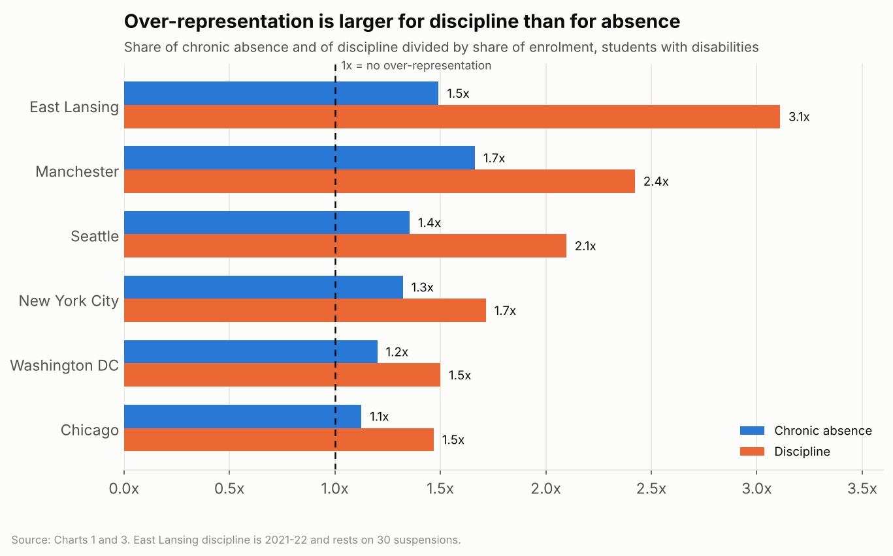

# Six-city brief: chronic absence, disability and discipline in public schools (November 2026)

**Cities:** Manchester (city council area), New York City, Seattle, Washington DC, Chicago, East Lansing.
**Pulled:** 2026-11-12 to 2026-11-14. **Status:** research files for review. Nothing in the seed data or import CSVs was changed.

**Scope rule:** public schools only, no private schools. Every figure comes from a government source: DfE (England), NYC DOE, OSPI (Washington State), OSSE (DC), ISBE (Illinois), CEPI MI School Data (Michigan) and the US Department of Education (EDFacts and the Civil Rights Data Collection).

Every number in the charts is in `data/*.csv`, with its source on each row. `build_charts.py` rebuilds every chart from those CSVs, offline.

---

## The answers at a glance

| Question | Short answer |
|---|---|
| **1. What share of chronically absent students have a disability?** | **18–36%** across the six cities: Manchester **36.1%**, New York City **31.6%**, Seattle **24.1%** (31.5% counting 504 plans), Washington DC **23.9%**, Chicago **about 19%** (about 22% counting 504 plans), East Lansing **17.6%**. In every city that is more than their share of enrolment. |
| **2. Intellectual or physical disabilities specifically** | Only England publishes absence by type of need. In Manchester, **6.1%** of persistently absent pupils have an intellectual need and **1.7%** a physical or sensory need. The largest SEN groups are social, emotional and mental health (11.7%) and speech and language (8.1%). |
| **3. Discipline involving these students** | No city links discipline to attendance, so this covers all students with disabilities. They account for **23–53%** of discipline: Manchester **52.8%** of suspensions, New York City **41.0%** of removals and suspensions, Seattle **36.9%** of disciplined students, East Lansing **36.7%** of suspensions (2021-22), Washington DC **28.2%** of students suspended, Chicago **23.2%** of suspensions. That is **1.5–3.1 times** their share of enrolment. |

---

## 1. Share of chronically absent students who have a disability

| City | Year | Chronically absent | With a disability | Share | Incl. 504 | Share of all students | Schools covered |
|---|---|---|---|---|---|---|---|
| Manchester | 2024/25 | 15,728 | 5,672 | **36.1%** | – | 21.7% | All state-funded schools, incl. academies |
| New York City | 2024-25 | 269,051 | 84,991 | **31.6%** | – | 23.9% | NYC DOE schools, K-12, no charters |
| Seattle | 2024-25 | 11,946 | 2,877 | **24.1%** | 31.5% | 17.8% | Seattle Public Schools |
| Washington DC | 2024-25 | ≈34,112 | ≈8,163 | **23.9%** | – | 19.9% | DCPS and public charter schools, K-12 |
| Chicago | 2024-25 | ≈122,715 | ≈23,127 | **18.8%** | 21.6% | 16.7% | Chicago Public Schools, incl. charters |
| East Lansing | 2024-25 | 997 | 175 | **17.6%** | – | 11.8% | East Lansing Public Schools |

≈ = estimated as a published rate times a student count (`data/chronic_absence_by_disability.csv`).

### How often each group is chronically absent

Students with disabilities are chronically absent more often in every city. Manchester has the widest gap (31.2% vs 14.6%). Washington DC has the highest rate (48.3%). Chicago has the smallest gap, with high rates for both groups.

### England and Greater Manchester over time

The SEN share of persistent absence rose from 26.7% to 32.0% in England and from 27.5% to 33.0% in Greater Manchester between 2022/23 and 2024/25 (`data/england_and_greater_manchester_persistent_absence_by_sen.csv`).

### US cross-check on one federal definition (2022-23)

On the US Department of Education's own file, counting IEPs and 504 plans together, four of the five US cities fall between 22.9% and 24.1%, with Seattle at 28.9%. This is the only source that lines all five up on identical definitions (`data/us_federal_chronic_absence_by_disability_2022_23.csv`).

---

## 2. Intellectual or physical disabilities

| Group | Main needs included | Pupils | Share of persistently absent |
|---|---|---|---|
| Intellectual | Moderate, severe or profound learning difficulty; Down syndrome | 952 | **6.1%** |
| Physical or sensory | Physical disability; hearing, visual or multi-sensory impairment | 265 | **1.7%** |

England-wide the same groups are 5.0% and 1.5%; Greater Manchester-wide 5.6% and 1.6%. The US cities publish absence only for students with disabilities as a whole, not by disability category (`data/manchester_persistent_absence_by_sen_need_2024_25.csv`).

---

## 3. Discipline involving students with disabilities

| City | Year | What is counted | Total | With a disability | Share | Share of students |
|---|---|---|---|---|---|---|
| Manchester | 2024/25 | Suspensions | 11,282 | 5,960 | **52.8%** | 21.8% |
| Manchester | 2024/25 | Permanent exclusions | 109 | 69 | **63.3%** | 21.8% |
| New York City | 2024-25 | Removals and suspensions | 35,963 | 14,759 | **41.0%** | 23.9% |
| Seattle | 2024-25 | Students suspended or expelled | 1,000 | 369 (+57 with a 504 plan) | **36.9%** | 17.6% |
| East Lansing | 2021-22 | Out-of-school suspensions | 30 | 11 | **36.7%** | 11.8% |
| Washington DC | 2024-25 | Students given out-of-school suspension | ≈6,087 | ≈1,717 | **28.2%** | 18.8% |
| Chicago | 2024-25 | In- and out-of-school suspensions | 20,758 | 4,821 | **23.2%** | 15.8% |

More detail: New York City suspensions alone are 40.0% (10,858 of 27,143). Chicago out-of-school suspensions alone are 23.5% (2,527 of 10,756). In Manchester 1,932 of the 4,229 pupils suspended at least once had SEN (45.7%). Michigan does not publish discipline by disability, so East Lansing comes from the federal Civil Rights Data Collection, whose latest year is 2021-22 (`data/discipline_by_disability.csv`, `data/us_crdc_out_of_school_suspensions_by_disability_2021_22.csv`).

### Over-representation, side by side

Dividing each share by the share of students with a disability: absence is 1.1–1.7 times enrolment share, discipline 1.5–3.1 times. In every city, discipline over-representation is larger than absence over-representation.

---

## Method, by city

| City | Absence source | Discipline source |
|---|---|---|
| Manchester | DfE *Pupil absence in schools in England* 2024/25, data set "Absence by pupil characteristics" (EES data set file e2eb493a-dc95-41f4-96ef-b886c5cd2019), Manchester LA, education phase Total, six half terms; SEN = EHC plan + SEN support. | DfE *Suspensions and permanent exclusions in England* 2024/25, "by characteristic" (EES data set file ae917392-59b2-4d62-b898-c8286adbc02e), Manchester LA, SEN provision. |
| New York City | NYC DOE InfoHub, *End-of-Year Attendance and Chronic Absenteeism Data*, citywide file, SWD tab; grades K-12 summed (pre-K excluded). | NYC DOE *Local Law 93 annual report on student discipline* (October 2025, 2024-25), SWD sheet, Grand Total row. |
| Seattle | OSPI *Report Card SQSS 2024-25* (data.wa.gov f7j6-nk2h), district level, all grades; chronically absent = denominator minus students with regular attendance. | OSPI *Report Card Discipline 2024-25* (data.wa.gov c9tq-ntbq), district level, all grades. |
| Washington DC | OSSE *DC School Report Card 2025*, Attendance metric scores, state level (DCPS and charters); count = rate × metric N. | OSSE *DC School Report Card 2025*, Discipline metric scores, state level; out-of-school suspension rate × metric N. |
| Chicago | ISBE *2025 Illinois Report Card public data set*, General sheet, district 299: chronic absenteeism rates (total, IEP, children with disabilities) × October 1 enrolment; total excludes pre-K. | Same file, Discipline sheet: discipline incidents, total and IEP. |
| East Lansing | CEPI MI School Data, K-12 data file *Student Counts: Attendance*, 2024-25, statewide file, district "All Buildings" rows. MI School Data only sends this file by email on request. | US Dept. of Education CRDC 2021-22, school-level Suspensions file, LEA 2612600. |

The federal cross-checks use EDFacts FS195 (SY2022-23 LEA file, Ed Data Express) and CRDC 2021-22.

## Gaps and caveats (read before publishing)

- **Disability definitions differ.** England's SEN (about 22% of Manchester pupils) is a broader group than a US IEP, which partly explains Manchester's higher shares. 504 plans are shown separately where published (Seattle, Chicago) and are not in the other cities' figures.
- **Absence definitions are close but not identical.** England counts 10% of possible sessions. US cities count 10% of enrolled days. Seattle counts students not attending regularly (about 2 or more absences a month).
- **Discipline is not linked to attendance anywhere,** so discipline figures describe all students with disabilities, not the chronically absent ones specifically.
- **Cities count discipline differently.** Manchester, New York City and Chicago count actions. Seattle and DC count students. New York City includes teacher removals.
- **Estimates.** DC and Chicago counts are rate × student count. Chicago's IEP enrolment may include pre-K students, which would slightly overstate its IEP count.
- **East Lansing discipline is old and small:** 2021-22, 30 suspensions in total. Its 3.1× ratio swings a lot with a handful of cases.
- **NYC excludes charter schools;** DC and Chicago include them; Seattle's few charter schools are separate districts and are not included.

## Files

| File | Contents |
|---|---|
| `data/chronic_absence_by_disability.csv` | Chart 1, 2 and the absence table: one row per city |
| `data/discipline_by_disability.csv` | Chart 3 and the discipline table; `primary_measure` marks the row charted per city |
| `data/manchester_persistent_absence_by_sen_need_2024_25.csv` | Chart 5: Manchester by main SEN need |
| `data/england_and_greater_manchester_persistent_absence_by_sen.csv` | Chart 7: England and Greater Manchester, 2022/23 to 2024/25 |
| `data/us_federal_chronic_absence_by_disability_2022_23.csv` | Chart 6: EDFacts cross-check |
| `data/us_crdc_out_of_school_suspensions_by_disability_2021_22.csv` | CRDC discipline cross-check for all five US cities |
| `build_charts.py` | Rebuilds `charts/*.png` from `data/` |

An interactive dashboard and a 12-slide deck were also built from these numbers as private claude.ai artifacts; they are not stored in this repository.
