# Six-city social brief: farm tariff aid, addiction and deprivation, and loss of public aid (November 2026)

**Cities:** New York City, Chicago, Seattle, Washington DC, Greater Manchester, Dublin
**Pulled:** 2026-11-10. **Status:** research files for review. Nothing in the seed data or import CSVs was changed.

**Scope rule:** the figures come from government statistical agencies: USDA ERS/FNS, CDC NCHS, SAMHSA, U.S. Census Bureau, CMS, ONS, MHCLG, DWP, Ireland's Health Research Board (HRB), CSO and the Dublin Region Homeless Executive. Four exceptions are labelled where they are used:
- farmdoc daily (University of Illinois) supplied the Farmer Bridge Assistance rate table, because the USDA press-release page refused automated access.
- American Farm Bureau Federation (AFBF) and National Agricultural Law Center analyses of U.S. Courts data supplied the farm bankruptcy counts.
- KFF compilations of CMS data supplied two national Medicaid figures.
- HRB & Pobal (Irish government bodies) supplied the deprivation analysis.

Every number in the charts is in `data/*.csv`, with its source on each row. `build_charts.py` rebuilds every chart from those CSVs, offline.

---

## The answers at a glance

| Question | Short answer |
|---|---|
| **1. How are farmers coping with tariff aid?** | Federal payments now make up **about 30% of U.S. net farm income** ($47.4B of $158.4B forecast for 2026), up from 8% in 2024. Excluding federal payments and crop insurance, farm income falls **26%** this year. Costs (+$21B) and debt (a record **$605B**) are rising. Chapter 12 farm bankruptcies rose **46% in 2025** and are up another **19%** in 2026 so far. The $12B "Farmer Bridge Assistance" payment is uneven: **$132.89/acre for rice vs. $30.88 for soybeans**, the crop most exposed to the China trade fight. |
| **2. Addiction per capita vs. socioeconomic status** | No government publishes an "addict percentage" by city. The best official measures all show the same thing: **the poorer the area, the higher the rate.** In NYC, borough poverty and overdose deaths correlate at **r = 0.90**. The Bronx (28.7% poverty) has **42.3** deaths per 100k, against **12.6** in Queens. In Greater Manchester, the most deprived borough (Manchester) has **nearly twice England's** drug-death rate. In Ireland, treatment rates in the most deprived neighbourhoods are **13 times** those in the most affluent (heroin: **41 times**). The link is **weaker *between* cities** (r = 0.41): Seattle has low poverty but a high overdose rate. |
| **3. Share of people cut off from aid** | No city publishes a single "% cut off" figure. The closest official measures, for the latest 12 months: SNAP food aid fell **21.6% in Illinois**, **9.3% in New York**, **7.6% in Washington State**, **6.9% in DC** and **13.3% nationally** (5.5 million fewer people). Medicaid is down **16–23%** in all four states since March 2023. In Britain, **5.2%** of Universal Credit claimants with work conditions are under a sanction. Greater Manchester issues about **3,400** new sanctions a month. In Dublin, **12,429 people (0.85% of residents)** are in homeless emergency accommodation, up 5.5% in a year. |

---

## Question 1: How are U.S. farmers dealing with tariff-related aid?

*This is a national question. None of the six cities is a farm economy, so the data below is U.S.-wide.*

### What the aid is
- **Farmer Bridge Assistance (FBA):** a **$12 billion** package announced in December 2025. **$11 billion** goes to row crops as one-time payments per 2025 planted acre. The rest goes to specialty crops through a separate program (*Assistance for Specialty Crop Farmers*).
- **Terms:** the payment limit is **$155,000 per person or entity**. Farmers with average adjusted gross income above **$900,000** are not eligible. Payments were scheduled by **February 28, 2026**.
- **Not a rebate:** FBA is a direct federal payment. It does not refund tariffs that farmers paid.

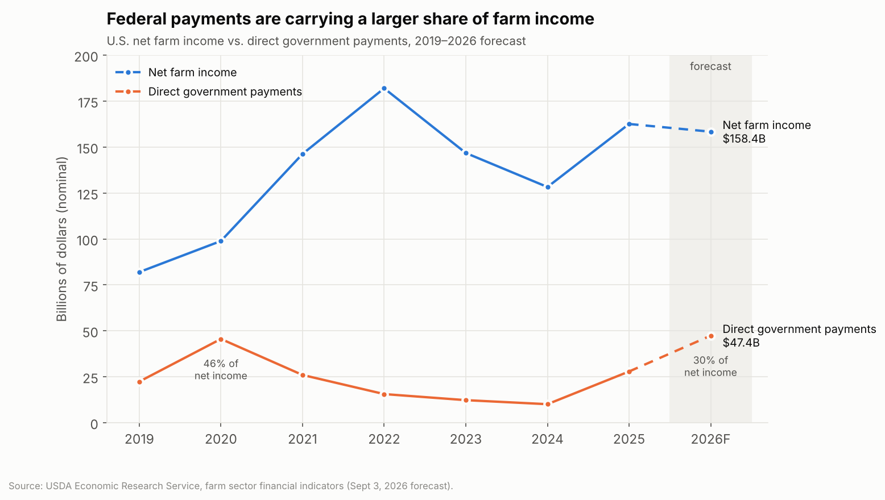

| Year | Net farm income ($B) | Direct government payments ($B) | Payments as % of net income |
|---|---|---|---|
| 2019 | 82.0 | 22.4 | 27.4% |
| 2020 | 98.9 | 45.6 | 46.1% |
| 2022 | 182.0 | 15.6 | 8.6% |
| 2024 | 128.3 | 10.1 | 7.9% |
| 2025 | 162.6 | 27.9 | 17.1% |
| **2026 (forecast)** | **158.4** | **47.4** | **29.9%** |

*Source: USDA ERS, farm sector financial indicators, September 3, 2026 forecast (`data/farm_income_ers_2019_2026f.csv`).*

### What the numbers say about how farmers are coping
1. **Aggregate income is being held up by Washington.** Direct government payments are forecast to rise **$19.5B (+70%)** in 2026, to the highest level in the 2019–2026 series. Even so, net farm income is still forecast to **fall 2.6%** ($4.3B), or **5.5%** after inflation.
2. **Market income is falling hard.** ERS says net farm income *excluding* government payments and net crop-insurance payments falls **$34B (−26%)** in 2026, to its lowest level since 2020.
3. **Most of the new money is not tariff aid.** ERS expects about **$15B** in 2026 from the Farm Bill's ARC and PLC programs, which pay out automatically when prices fall. That is more than the forecast rise in FBA and other ad hoc payments.
4. **Costs and debt are climbing.** Total expenses are forecast at **$492.8B** (+4.5%). Farm debt is forecast at a record **$605.1B** (+4.6%).
5. **Distress is rising despite the aid.** Chapter 12 (family farm) bankruptcy filings:

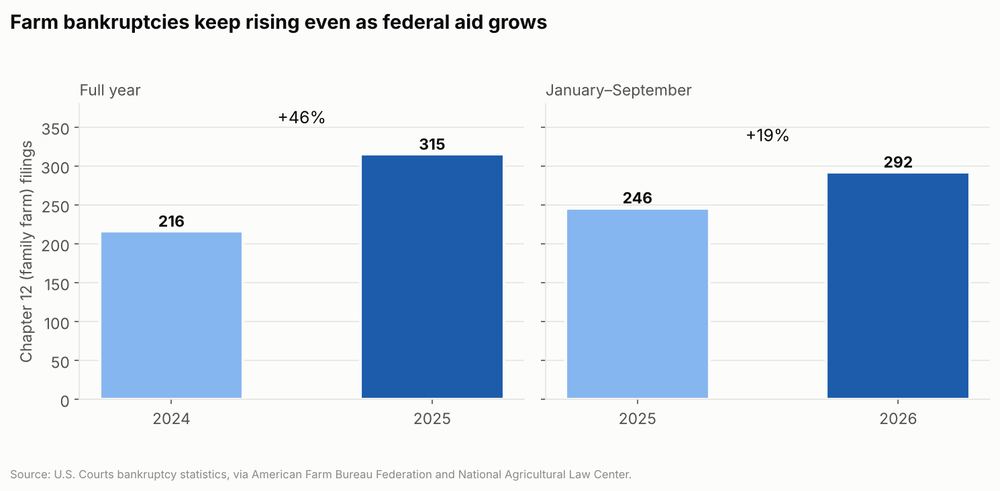

| Period | Filings | Change |
|---|---|---|
| 2024, full year | 216 | |
| 2025, full year | 315 | **+46%** |
| Jan–Sep 2025 | 246 | |
| Jan–Sep 2026 | 292 | **+19%** |

*Source: U.S. Courts data, as analysed by AFBF and the National Agricultural Law Center. Chapter 12 only covers farmers who earn most of their income from farming, so it undercounts distress.*

6. **Payments are uneven across crops.** Rice and cotton get roughly 4× the per-acre rate of soybeans. Soybeans are the crop most exposed to lost Chinese demand.

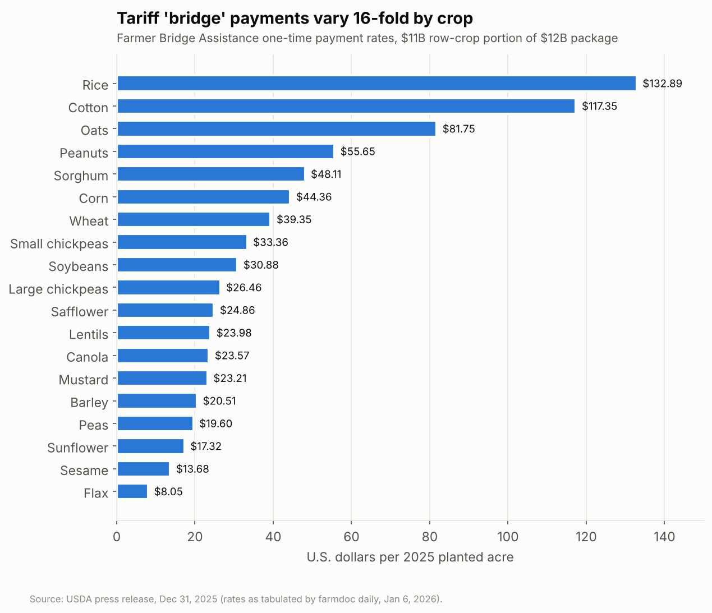

**Bottom line:** the aid has kept *average* farm finances near break-even. ERS forecasts **median farm-household income at $108,460** (+~5%). But the share of income that comes from the government is back at pandemic-era levels. Costs and debt are at records, and bankruptcies are rising. Farms that depend on the market, especially soybean, livestock-feed and specialty growers, are under the most strain.

---

## Question 2: Addiction per capita and socioeconomic status

### Important: what "addiction rate" can mean
No agency in any of the three countries publishes a count of people with addiction for a city. This brief uses three official proxies. **They measure different things, so do not compare them directly across countries.**

| Measure | Countries | What it captures |
|---|---|---|
| **Substance use disorder (SUD) prevalence** | U.S. (state level only) | % of people aged 12+ meeting clinical (DSM-5) criteria in the past year. Survey-based. |
| **Overdose / drug-misuse death rate** | U.S. (county), England (borough) | Deaths per 100,000. Captures the most severe harm only. U.S. rates are crude; ONS rates are age-standardised and use a narrower definition. |
| **Treatment rate** | Ireland | Treatment episodes per 10,000. Depends on access to treatment as well as need. |

### Overall prevalence (U.S.)

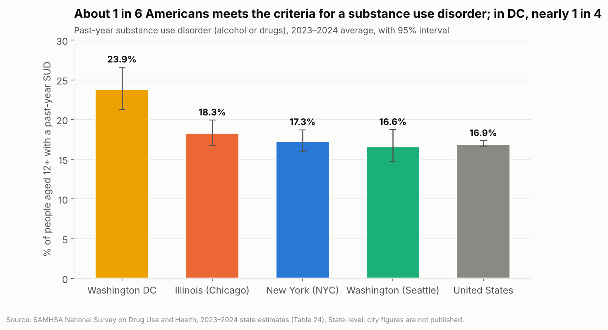

| State (city) | Any SUD | Drug use disorder | Alcohol use disorder | Opioid use disorder |
|---|---|---|---|---|
| Washington DC | **23.9%** | 13.3% | 15.8% | 1.0% |
| Illinois (Chicago) | 18.3% | 10.4% | 11.9% | 1.9% |
| New York (NYC) | 17.3% | 10.2% | 9.6% | 1.8% |
| Washington (Seattle) | 16.6% | 9.6% | 9.4% | 1.6% |
| United States | 16.9% | 9.7% | 9.9% | 1.7% |

*Source: SAMHSA NSDUH 2023–2024 state estimates (`data/nsduh_substance_use_disorder_2023_2024.csv`).*

### Overdose death rates over time (U.S. cities)

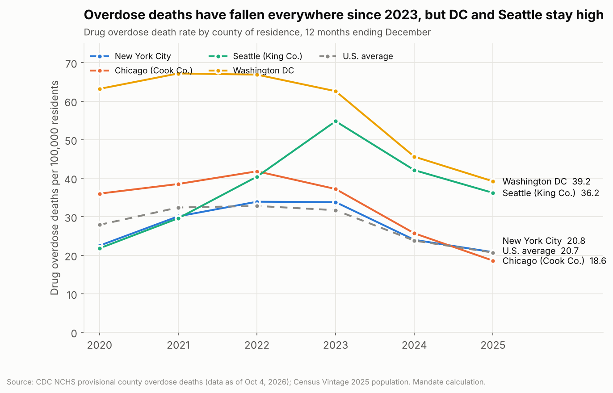

| Place | 2022 | 2023 | 2024 | **2025** | Change from peak |
|---|---|---|---|---|---|
| Washington DC | 66.9 | 62.6 | 45.6 | **39.2** | −42% from 2021 |
| Seattle (King Co.) | 40.4 | 54.8 | 42.1 | **36.2** | −34% from 2023 |
| New York City | 33.9 | 33.8 | 24.0 | **20.8** | −39% from 2022 |
| Chicago (Cook Co.) | 41.8 | 37.2 | 25.7 | **18.6** | −55% from 2022 |
| U.S. | 32.8 | 31.7 | 23.8 | **20.7** | −37% from 2022 |

*Deaths per 100,000 residents. Source: CDC NCHS provisional county data (as of October 4, 2026) ÷ Census Vintage 2025 population. 2025 figures are provisional.*

### The link to socioeconomic status

**United States: poverty vs. overdose deaths, eight counties**

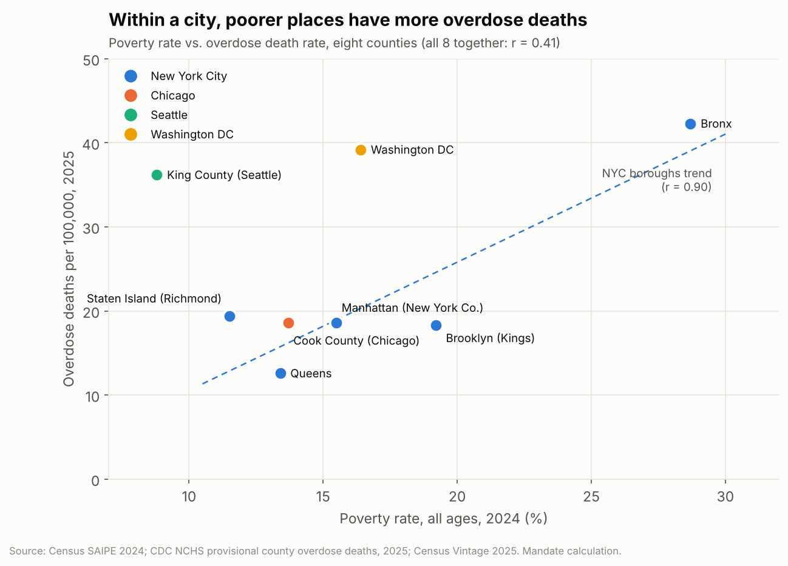

| County | Poverty rate 2024 | Median household income | Overdose deaths per 100k, 2025 |
|---|---|---|---|
| Bronx | **28.7%** | $46,486 | **42.3** |
| Washington DC | 16.4% | $109,289 | 39.2 |
| King Co. (Seattle) | 8.8% | $121,984 | 36.2 |
| Staten Island | 11.5% | $96,437 | 19.4 |
| Manhattan | 15.5% | $105,713 | 18.6 |
| Cook Co. (Chicago) | 13.7% | $82,729 | 18.6 |
| Brooklyn | 19.2% | $80,696 | 18.3 |
| Queens | 13.4% | $84,684 | 12.6 |

- **Within NYC:** poverty and overdose deaths correlate at **r = 0.90** across the five boroughs. The Bronx, the poorest borough, has **3.4×** the rate of Queens.
- **Across cities the link is weaker (r = 0.41).** Seattle is the outlier: it has the lowest poverty here but the third-highest overdose rate. Fentanyl reached the West Coast later than the East, and King County's deaths peaked in 2023. Poverty is a strong risk factor, but it is not the only one.

**Greater Manchester: deprivation vs. drug-misuse deaths**

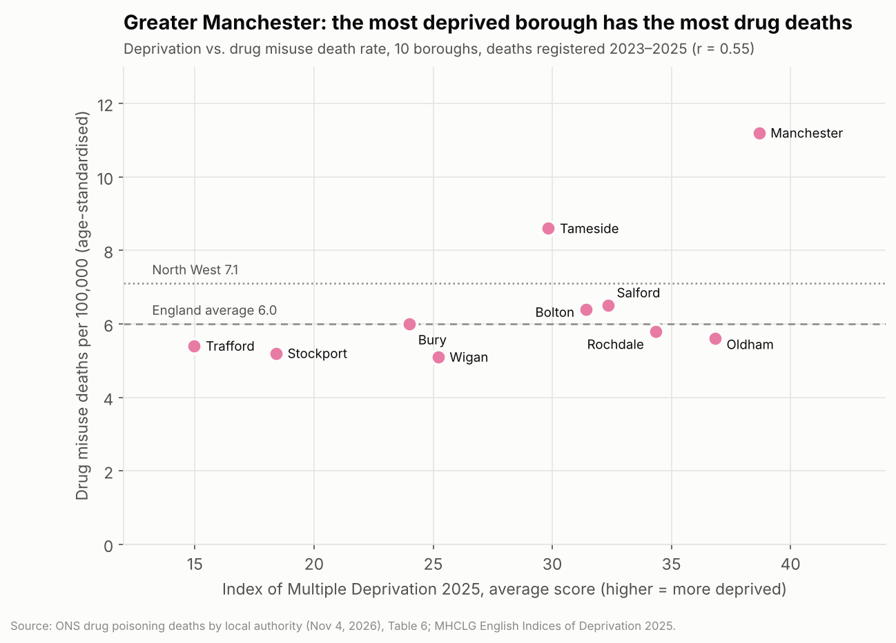

| Borough | Drug-misuse deaths per 100k (2023–25) | Deaths | IMD 2025 rank (1 = most deprived of 296) |
|---|---|---|---|
| Manchester | **11.2** | 168 | **4** |
| Tameside | 8.6 | 58 | 44 |
| Salford | 6.5 | 53 | 24 |
| Bolton | 6.4 | 55 | 30 |
| Bury | 6.0 | 34 | 90 |
| Rochdale | 5.8 | 39 | 17 |
| Oldham | 5.6 | 39 | 11 |
| Trafford | 5.4 | 37 | 201 |
| Stockport | 5.2 | 46 | 158 |
| Wigan | 5.1 | 50 | 78 |
| *North West* | *7.1* | | |
| *England* | *6.0* | | |

*Source: ONS, drug poisoning deaths by local authority (released November 4, 2026), Table 6; MHCLG English Indices of Deprivation 2025.* The correlation between deprivation score and death rate is **r = 0.55**, but it is driven mainly by Manchester. Oldham and Rochdale are very deprived but sit below the England average. Small boroughs have wide confidence intervals; see the ONS file.

**Dublin / Ireland: treatment by neighbourhood deprivation**

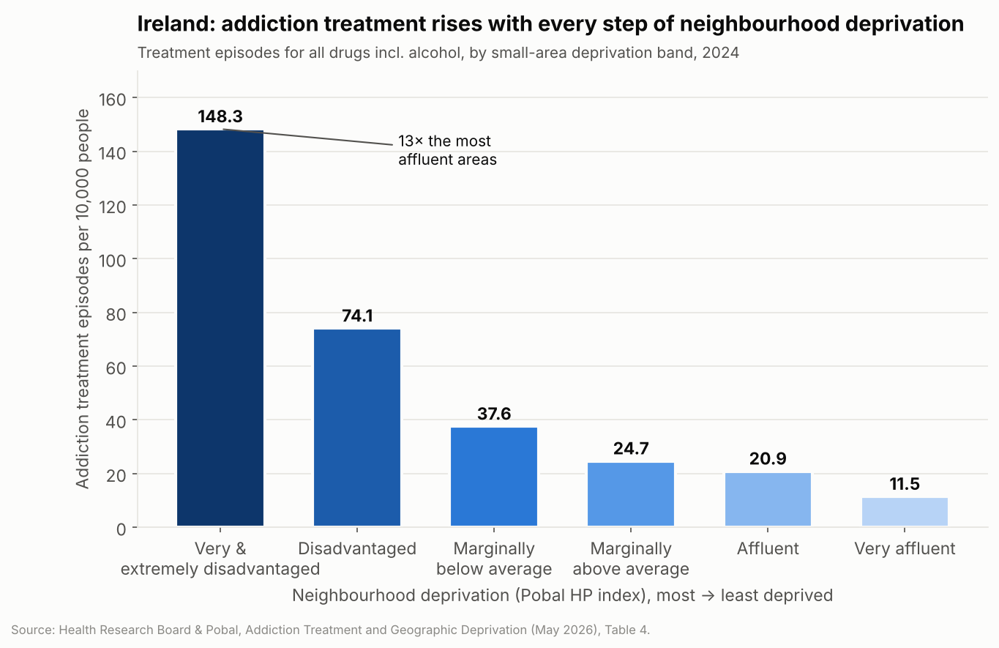

- Treatment in the **most deprived** areas runs at **148.3 per 10,000**, against **11.5** in the most affluent: **13 times higher**. For heroin it is **41 times** higher; for alcohol, 7.5 times. In the three HSE regions that include Dublin, the gap is **13–16 times**.
- **County Dublin** has **28%** of Ireland's population but **52%** of cocaine treatment cases (3,425 of 6,535 in 2025).
- **Who is in treatment (Ireland, 2025):** 15,422 cases. **59.2% unemployed**, **20.8%** in paid work, **11.6% homeless**, and **31%** left school before age 16.
- **Drug-poisoning deaths:** 343 in Ireland in 2022, the latest year published; almost half of those who died lived in Dublin.

*Sources: HRB & Pobal (May 2026), Table 4; HRB National Drug Treatment Reporting System 2025, Tables 7 and 13; HRB National Drug-Related Deaths Index 2022.*

**Bottom line for Question 2:** in every place with neighbourhood-level data (NYC boroughs, Greater Manchester boroughs, Irish small areas), more deprivation goes with more addiction harm. The gradient is steepest for heroin and opioids. Between cities, drug-supply timing and treatment access also matter, which is why Seattle and DC rank high. These are correlations, not proof that poverty causes addiction. The relationship runs both ways.

---

## Question 3: What share of people have been cut off from public services and aid?

### Important: what can and cannot be measured
No government in these three countries publishes "% of residents cut off from aid" for a city. The table below uses the closest official measures. Not everyone who leaves a program was cut off: some leave because their income rose or they found other coverage. Administrative data does not record the reason.

| City | Measure (latest) | Change | As % of all residents |
|---|---|---|---|
| **Chicago** (Illinois) | SNAP participants, Jul 2025 → Jul 2026 | **−21.6%** (407,079 fewer) | 3.2% of Illinoisans |
| | Medicaid/CHIP, Mar 2023 → Jul 2026 | **−23.4%** (894,219 fewer) | 7.0% |
| **New York City** (NY State) | SNAP | **−9.3%** (272,988 fewer) | 1.4% |
| | Medicaid/CHIP | **−15.8%** (1,189,681 fewer) | 5.9% |
| **Seattle** (Washington State) | SNAP | **−7.6%** (68,549 fewer) | 0.9% |
| | Medicaid/CHIP | **−18.9%** (414,366 fewer) | 5.2% |
| **Washington DC** | SNAP | **−6.9%** (9,665 fewer) | 1.4% |
| | Medicaid/CHIP | **−20.0%** (59,229 fewer) | 8.5% |
| **United States** | SNAP | **−13.3%** (5,515,381 fewer) | 1.6% |
| **Greater Manchester** | Universal Credit claimants with work conditions who are under a sanction (Great Britain, May 2026) | **5.2%** (106,589 people in GB) | GM-level rate not published |
| | New adverse sanction decisions, GM Jobcentre district | ~**3,400/month** (Apr 2026), up from ~2,300 (Apr 2023) | |
| **Dublin** | People in homeless emergency accommodation (Aug 2026) | **12,429**, +5.5% in a year (4,158 children) | **0.85%** of Dublin residents |

*The U.S. figures are state-level, because SNAP and Medicaid are run and reported by states. "% of residents" uses Census Vintage 2025 state populations; Dublin uses the CSO Census 2022 population (1,458,154). The GM monthly estimate is a Mandate calculation: DWP publishes the district count only for claimants who declared an ethnicity (74.9% response), and the count is scaled up by that rate.*

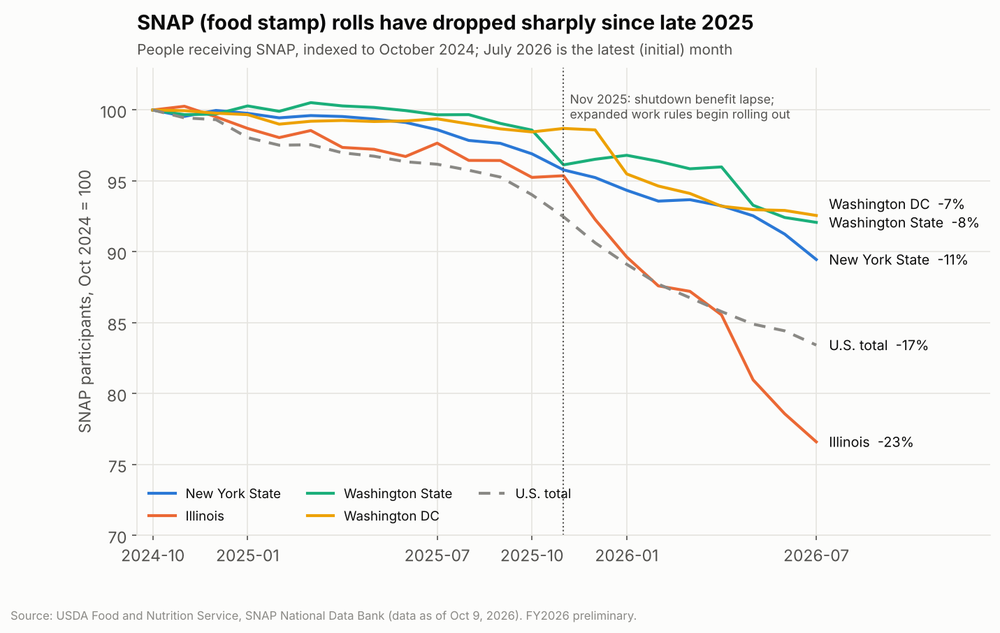

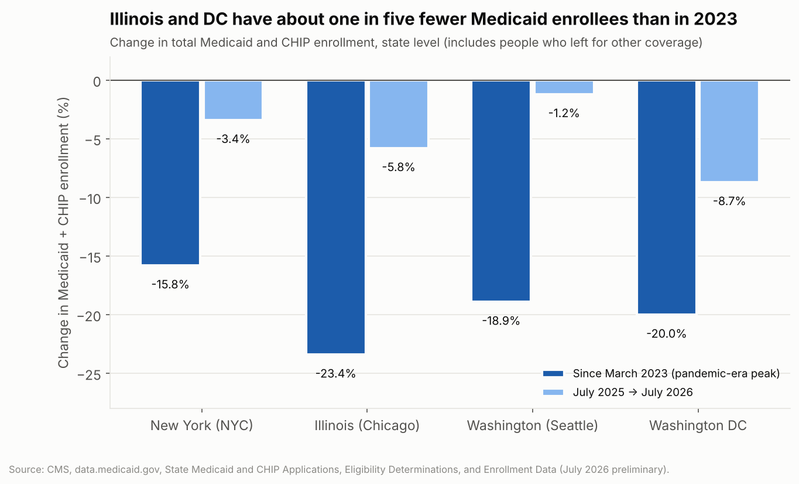

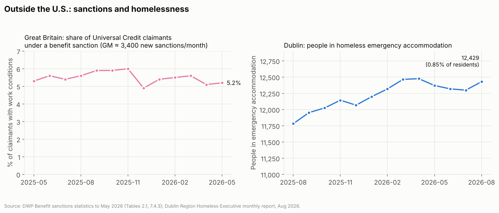

### Why the U.S. numbers are moving
- **SNAP:** the 2025 budget reconciliation law (H.R. 1, signed July 4, 2025) did two things. It extended SNAP work requirements to adults aged 55–64 and to parents of children aged 14 and over, and removed exemptions for veterans, homeless people and former foster youth. It also shifts more costs to states. States began applying the new rules from late 2025. In November 2025, the federal shutdown also disrupted benefits while courts fought over whether USDA had to pay. National SNAP participation has fallen every month since. USDA itself says participation fluctuates and that no single policy explains the drop.
- **Medicaid:** most of the fall since 2023 is the post-pandemic "unwinding" of continuous enrollment. In a KFF compilation of CMS data, **25.2 million** people were disenrolled nationally, and **69%** of them lost coverage for **procedural (paperwork) reasons**, not because they were found ineligible. Enrollment has kept falling: by about **7% nationally from July 2025 to July 2026** (KFF, from CMS data). **Medicaid work requirements under H.R. 1 start by January 1, 2027** (states can seek extensions), so a further drop is expected.

### Outside the U.S.
- **Greater Manchester:** the UK's work-conditionality sanctions are the closest equivalent of being "cut off". They reduce or stop a claimant's Universal Credit for a set period. The GB rate has stayed between about 5% and 7% since 2023. The UK government does not publish a borough-level rate in its tables; Stat-Xplore holds it.
- **Dublin:** Ireland has seen no comparable large-scale benefit cutoff in this period, and the Department of Social Protection's penalty-rate data could not be pulled. The main measure of people falling outside services is **homelessness**, which is at record levels. Nationally (CSO SILC 2025), **12.6%** of people are at risk of poverty and **4.7%** live in consistent poverty. The Eastern & Midland region, which includes Dublin, is lower, at 9.6% and 3.4%.

---

## Gaps and caveats (read before publishing)
1. **City vs. state:** SNAP, Medicaid and NSDUH figures are **state-level**. NYC is about 43% of New York State, Cook County about 41% of Illinois and King County about 29% of Washington State. City-level SNAP counts (NYC HRA, Cook County) were not reachable in this pull.
2. **Provisional data:** 2025 overdose counts are provisional (up to 25% of Cook County and 40% of Bronx records were pending). SNAP figures for June and July 2026 are preliminary or initial. Medicaid for July 2026 is preliminary.
3. **Not pulled:** NYC DOHMH neighbourhood-poverty overdose briefs (the site refused automated access); the DC medical examiner's ward-level data (no 2024–25 annual report online); the CBO score of SNAP/Medicaid losses under the final H.R. 1 (estimates for different versions of the bill disagree); GM borough-level sanction rates (need a Stat-Xplore account); Irish Department of Social Protection penalty-rate data (the site refused automated access).
4. **Secondary sources:** the FBA rates (farmdoc daily, quoting USDA), the bankruptcy counts (AFBF and NALC, quoting U.S. Courts) and the Medicaid unwinding figures (KFF, compiling CMS) come through reputable intermediaries. Verify them against the primary documents before publishing.
5. **Correlation ≠ causation.** The r values use 5–10 data points each and are descriptive only.

## Files
| File | Contents |
|---|---|
| `data/farm_income_ers_2019_2026f.csv` | ERS net farm income, payments, expenses, debt |
| `data/farmer_bridge_assistance_rates_2026.csv` | FBA $/acre by commodity |
| `data/farm_bankruptcies_chapter12.csv` | Chapter 12 filings |
| `data/nsduh_substance_use_disorder_2023_2024.csv` | SUD / AUD / DUD / OUD by state |
| `data/us_overdose_deaths_rate_2020_2025.csv` | Overdose deaths and rates, 4 cities + U.S. |
| `data/us_county_poverty_vs_overdose_2025.csv` | Poverty, income and overdose, 8 counties |
| `data/greater_manchester_drug_misuse_vs_deprivation.csv` | ONS drug-misuse rate + IMD 2025, 10 boroughs |
| `data/ireland_treatment_rate_by_deprivation_2024.csv` | HRB/Pobal treatment per 10k by deprivation band |
| `data/ireland_treated_drug_use_profile_2025.csv` | NDTRS socio-demographics, Dublin share |
| `data/snap_participation_monthly_fy2025_fy2026.csv` | Monthly SNAP persons, Oct 2024–Jul 2026 |
| `data/snap_participation_change_jul2025_jul2026.csv` | Year-on-year SNAP change |
| `data/medicaid_chip_enrollment_change.csv` | CMS Medicaid/CHIP enrollment change |
| `data/uk_universal_credit_sanction_rate.csv` | DWP UC sanction rate, GB |
| `data/greater_manchester_uc_adverse_sanction_decisions.csv` | GM district sanction decisions |
| `data/dublin_emergency_accommodation.csv` | DRHE monthly emergency accommodation |
| `build_charts.py` | Rebuilds `charts/*.png` from the CSVs (needs matplotlib; no network) |

## Primary sources
- USDA ERS, [Data files: U.S. and state-level farm income and wealth statistics](https://www.ers.usda.gov/data-products/farm-income-and-wealth-statistics/data-files-us-and-state-level-farm-income-and-wealth-statistics) (September 3, 2026 release) and the [September 3, 2026 farm income webinar transcript](https://www.ers.usda.gov/sites/default/files/2026_09_03%20Webinar%20Transcript_Farm%20Income.pdf)
- USDA, [Commodity payment rates for the Farmer Bridge Assistance Program](https://www.usda.gov/about-usda/news/press-releases/2025/12/31/usda-announces-commodity-payment-rates-farmer-bridge-assistance-program) (December 31, 2025); rates as tabulated in [farmdoc daily, January 6, 2026](https://farmdocdaily.illinois.edu/2026/01/farmer-bridge-assistance-program-payment-rates.html); [Federal Register FBA notice](https://www.federalregister.gov/documents/2026/02/23/2026-03456/farmer-bridge-assistance-fba-program)
- U.S. Courts bankruptcy statistics, via [Univ. of Arkansas / NALC, October 22, 2026](https://www.uaex.uada.edu/media-resources/news/2026/october/10-22-2026-ark-nalc-q3-bankruptcies.aspx) and [Investigate Midwest / AFBF, February 25, 2026](https://investigatemidwest.org/2026/02/25/farm-bankruptcies-jumped-46-in-2025-as-debt-loads-and-costs-rise/)
- CDC NCHS, [VSRR provisional county-level drug overdose deaths](https://data.cdc.gov/resource/gb4e-yj24.json) and [national counts](https://data.cdc.gov/resource/xkb8-kh2a.json) (data as of October 4, 2026)
- SAMHSA, [2023–2024 NSDUH state prevalence estimates](https://www.samhsa.gov/data/report/2023-2024-nsduh-state-prevalence-estimates)
- U.S. Census Bureau, [SAIPE 2024](https://www2.census.gov/programs-surveys/saipe/datasets/2024/2024-state-and-county/est24all.txt) and [Vintage 2025 county population estimates](https://www2.census.gov/programs-surveys/popest/datasets/2020-2025/counties/totals/co-est2025-alldata.csv)
- ONS, [Deaths related to drug poisoning by local authority, 1993–2025](https://www.ons.gov.uk/peoplepopulationandcommunity/birthsdeathsandmarriages/deaths/datasets/drugmisusedeathsbylocalauthority); MHCLG, [English Indices of Deprivation 2025](https://www.gov.uk/government/statistics/english-indices-of-deprivation-2025)
- HRB, [NDTRS 2025](https://www.drugsandalcohol.ie/45416/); HRB & Pobal, [Addiction treatment and geographic deprivation (2026)](https://www.drugsandalcohol.ie/45587/); HRB, [Drug poisoning deaths in Ireland in 2022](https://www.drugsandalcohol.ie/44591/)
- USDA FNS, [SNAP data tables](https://www.fns.usda.gov/pd/supplemental-nutrition-assistance-program-snap) (data as of October 9, 2026)
- CMS, [data.medicaid.gov: State Medicaid and CHIP applications, eligibility determinations and enrollment data](https://data.medicaid.gov/); KFF, [Medicaid enrollment and unwinding tracker](https://www.kff.org/medicaid/medicaid-enrollment-and-unwinding-tracker/)
- DWP, [Benefit sanctions statistics to May 2026](https://www.gov.uk/government/statistics/benefit-sanctions-statistics-to-may-2026)
- Dublin Region Homeless Executive, [Monthly report, August 2026](https://www.homelessdublin.ie/info/figures); CSO, [SILC 2025](https://www.cso.ie/en/releasesandpublications/ep/p-silc/surveyonincomeandlivingconditionssilc2025/)
