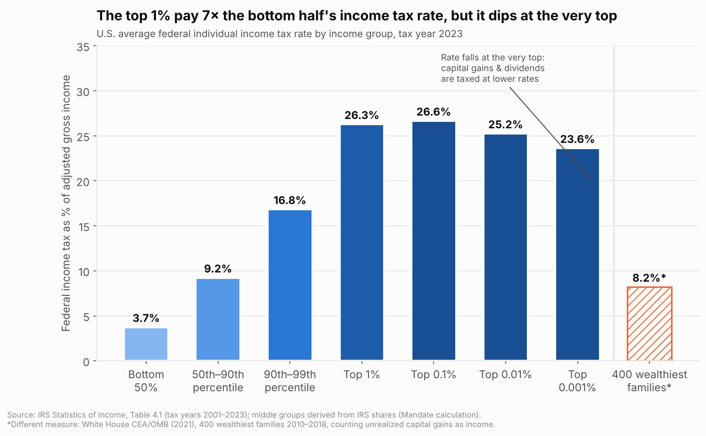
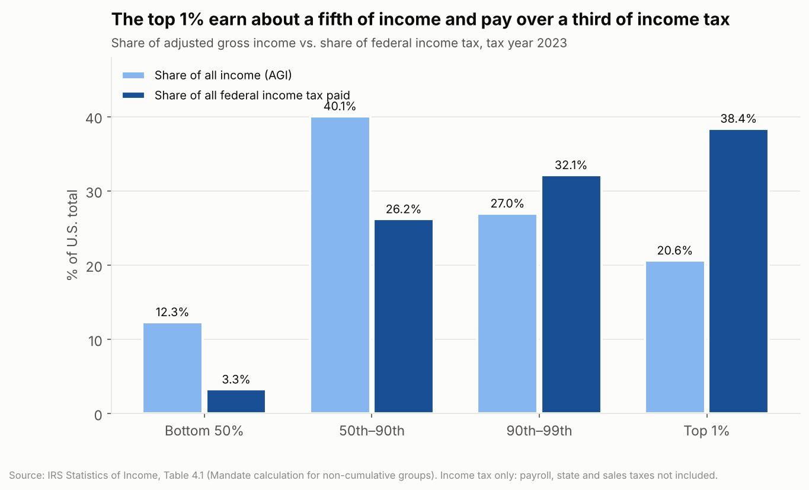
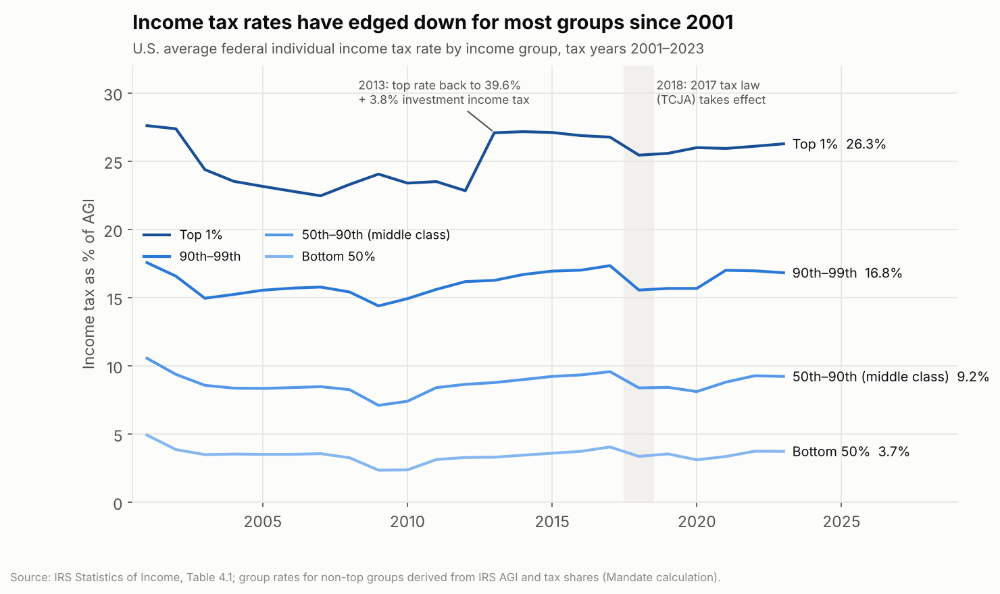
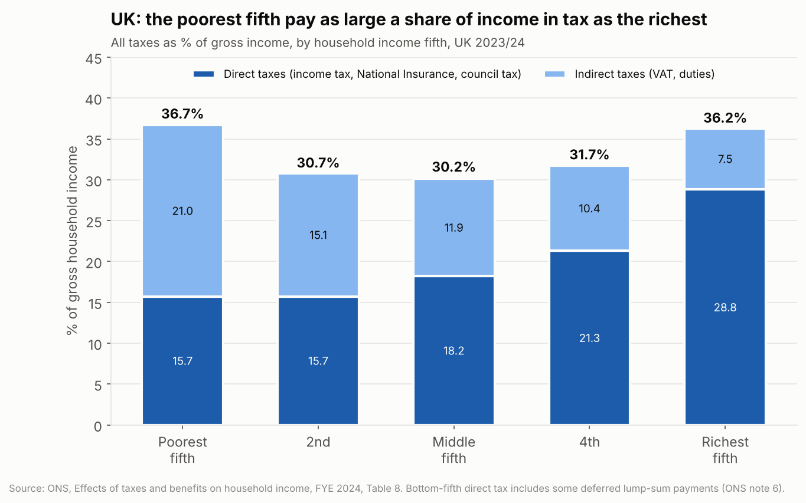
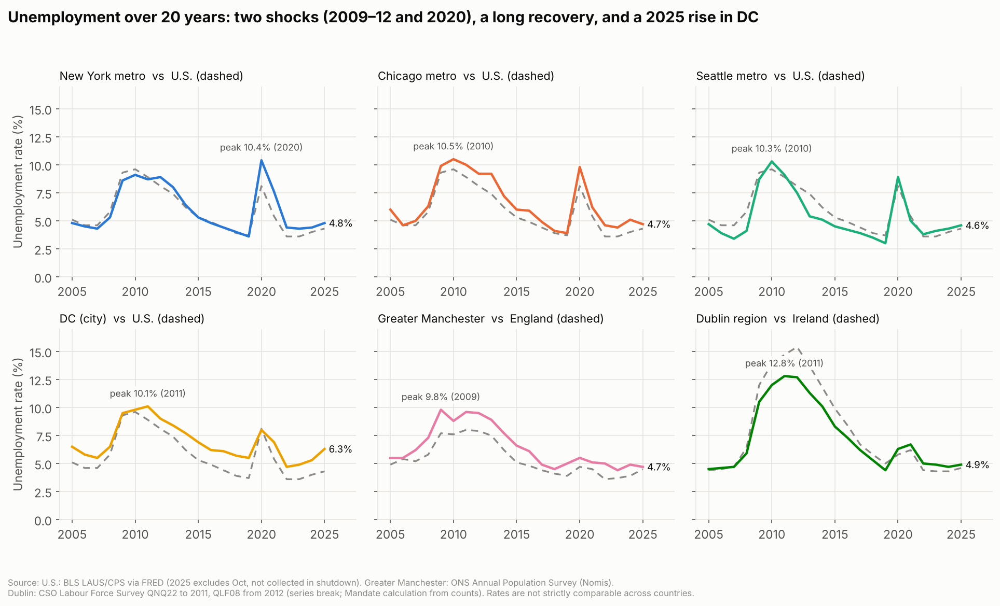
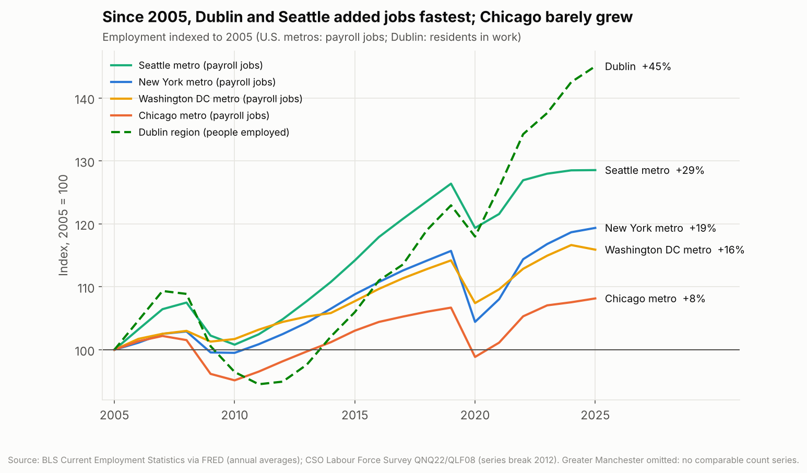
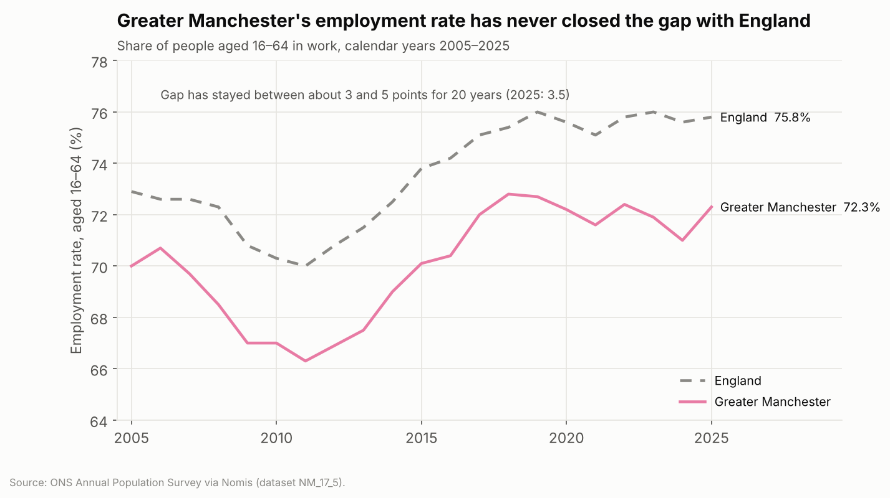
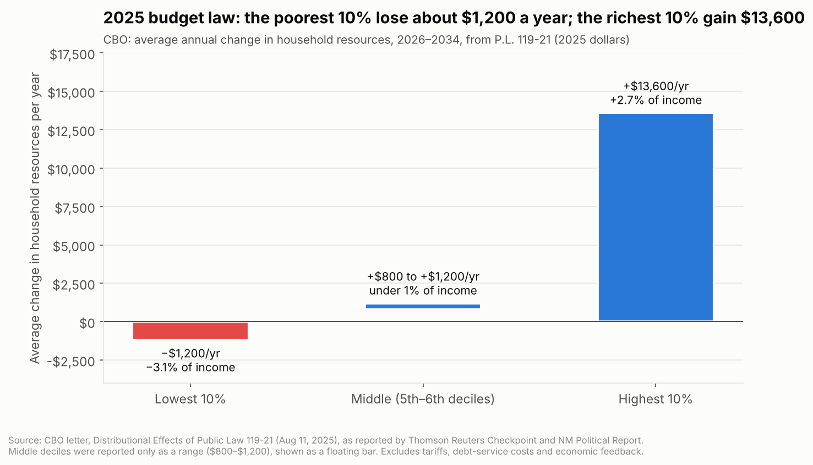
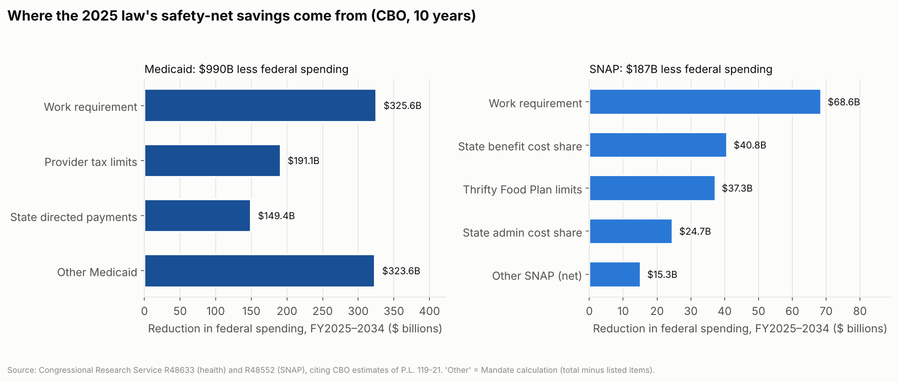
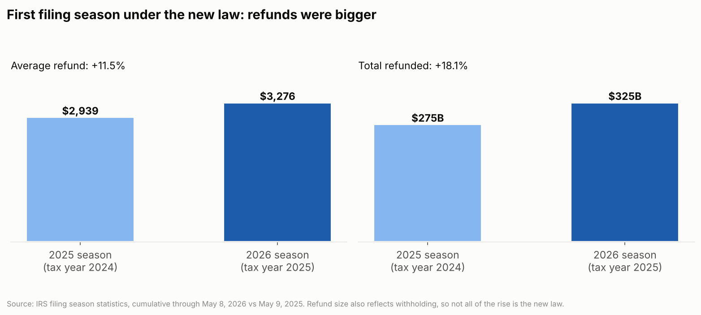

# Taxes by income, 20 years of jobs, and what the 2025 budget law did (November 2026)

**Cities:** New York City, Chicago, Seattle, Washington DC, Greater Manchester, Dublin
**Pulled:** 2026-11-10. **Status:** research files for review. Nothing in the seed data or import CSVs was changed.

**Scope rule:** government statistical agencies only, plus the Congressional Research Service (CRS) and two clearly labelled exceptions:
- **Government agencies used:** IRS, BLS, Census, CMS, USDA, CRS, ONS, DWP, CSO, the Irish parliament (Oireachtas) and the White House Council of Economic Advisers (CEA).
- **Exception 1, CBO and JCT figures:** cbo.gov and jct.gov sit behind a bot-check wall, so their files could not be downloaded. Their figures come through the Congressional Research Service and through named, reputable outlets (Thomson Reuters Checkpoint, the Tax Foundation) that quote CBO directly. Each one is labelled and should be verified against the CBO document before publishing.
- **Exception 2, FRED:** the St. Louis Federal Reserve's FRED database supplied the U.S. unemployment and jobs series. It republishes official BLS data, and was used because BLS's own API had hit its daily limit.

Every chart is built from `data/*.csv`, and every CSV row names its source. `build_charts.py` rebuilds all the charts offline.

---

## The answers at a glance

| Question | Short answer |
|---|---|
| **1. Tax rates: top earners vs. middle and lower classes** | **U.S., federal income tax only (IRS, 2023):** the bottom half paid **3.7%** of income, the middle class (50th–90th percentile) **9.2%**, the top 1% **26.3%**. The rate *falls* at the very top: the top 0.001% paid **23.6%**, because investment income is taxed at lower rates. Counting unrealized capital gains, a White House study put the **400 wealthiest families at 8.2%**. **UK, all taxes:** the poorest fifth pay **36.7%** of income in tax, the middle fifth **30.2%**, the richest fifth **36.2%**. The poor pay through VAT and duties, the rich through income tax. **Ireland:** the top 1% pay about **24%** of all income tax and USC; the top 10% pay **63%**. |
| **2. Employment over the past 20 years** | Every city went through the same two shocks: **2009–12** (unemployment peaked between 9.8% and 12.8%) and **2020**. All six have since recovered to roughly **4.6–6.3%** unemployment. **Job growth since 2005:** Dublin (+45% people in work) and Seattle (+29% jobs) grew fastest; Chicago grew slowest (+8%). **Warning signs:** the DC metro area has **lost 2.5% of its jobs** in 2026 against 2025 (about 86,000), and DC city unemployment rose to **6.3%** in 2025. Greater Manchester's employment rate has trailed England's by **3–5 points** for 20 years. |
| **3. What the 2025 budget law ("One Big Beautiful Bill") did to the average American** | **Middle-income households:** CBO estimates **+$800 to +$1,200 a year** (under 1% of income), mostly by keeping the 2017 tax cuts from expiring. Refunds in the 2026 filing season were **11.5% larger** ($3,276 vs. $2,939). **Lowest 10%:** **−$1,200 a year (−3.1%)**, mainly from Medicaid and SNAP cuts. **Highest 10%:** **+$13,600 a year (+2.7%)**. **Cost and coverage:** the law adds **$3.4 trillion** to deficits over 10 years and leaves **10 million more people uninsured** by 2034. The biggest Medicaid changes, work requirements and 6-month eligibility checks, **haven't started yet** (Dec 31, 2026 and Jan 1, 2027). |

---

## Question 1: How much do the wealthiest pay in tax compared with middle- and lower-income people?

### United States: federal income tax by income group

| Group (tax year 2023) | Share of all income (AGI) | Share of all federal income tax | Average income tax rate |
|---|---|---|---|
| Bottom 50% | 12.3% | 3.3% | **3.7%** |
| 50th–90th percentile ("middle class") | 40.1% | 26.2% | **9.2%** |
| 90th–99th percentile | 27.0% | 32.1% | **16.8%** |
| Top 1% | 20.6% | 38.4% | **26.3%** |
| Top 0.1% | 10.1% | 19.0% | **26.7%** |
| Top 0.01% | 4.7% | 8.5% | **25.2%** |
| Top 0.001% (about 1,500 returns) | 2.1% | 3.5% | **23.6%** |
| *All taxpayers* | *100%* | *100%* | *14.1%* |

*Source: IRS Statistics of Income, Table 4.1 (`data/us_income_tax_rate_by_percentile_irs_2001_2023.csv`). The bottom 50%, 50th–90th and 90th–99th rows are Mandate calculations from the IRS's published income and tax shares.*

**How to read this:**
1. **Federal income tax is progressive up to the top 0.1%.** The top 1%'s rate is 7 times the bottom half's. The top 1% earn about a fifth of all income and pay over a third of all income tax.
2. **It turns regressive at the very top.** The top 0.001% pay a *lower* rate (23.6%) than the top 0.1% (26.7%). More of their income is long-term capital gains and dividends, which are taxed at no more than 20% (plus 3.8%), against 37% on wages.
3. **The IRS measure misses income that is never taxed.** Unrealized gains (stock that rises in value but isn't sold) don't count as income. Counting them, a 2021 White House CEA/OMB study found the **400 wealthiest families paid an average 8.2%** in federal income tax over 2010–2018, with a range of 6–12% under different assumptions. That's a different measure from the IRS table, so it's shown as a separate, hatched bar.
4. **Payroll taxes change the picture for the middle.** Wage earners also pay 7.65% in Social Security and Medicare tax, and the Social Security part stops at an annual wage cap. Counting **all** federal taxes, CBO estimates the average rate in 2022 was **1.4%** for the lowest fifth, **23.2%** for the highest fifth and **31.5%** for the top 1%. *(Figures from CBO's "Distribution of Household Income, 2022", as reported by the Tax Foundation; verify against the CBO report.)*
5. **State and local taxes aren't here.** Sales and property taxes take a bigger share of income from lower earners. No federal agency publishes that breakdown for these four cities.

Income tax rates are slightly lower than in 2001 for every group. The top 1%'s rate rose in 2013, when the top rate returned to 39.6% and a 3.8% tax on investment income began. It dipped again in 2018 under the 2017 tax law.

### United Kingdom (Greater Manchester): all taxes by income fifth

| Income fifth (UK, 2023/24) | Direct taxes | Indirect taxes (VAT, duties) | **All taxes, % of gross income** |
|---|---|---|---|
| Poorest | 15.7% | 21.0% | **36.7%** |
| 2nd | 15.7% | 15.1% | **30.7%** |
| Middle | 18.2% | 11.9% | **30.2%** |
| 4th | 21.3% | 10.4% | **31.7%** |
| Richest | 28.8% | 7.5% | **36.2%** |

*Source: ONS, Effects of taxes and benefits on household income, 2023/24, Table 8.* The UK's overall tax burden is **U-shaped**: the poorest and richest fifths pay about the same share of their income. The middle pays the least. The poorest fifth's direct tax figure is partly inflated by one-off deferred tax payments (ONS note 6). Even without that, VAT and council tax take much more of a low income than a high one. ONS doesn't publish this for Greater Manchester alone.

### Ireland (Dublin)
| Group | Share of all income tax + USC | Source |
|---|---|---|
| Top 1% of taxpayer units (income above €290,000) | **~24%** (2024 projection) | Minister for Finance, parliamentary answer, Dáil, May 21, 2024 |
| Top 10% of earners (above €102,000) | **~63%** (2024 projection) | Department of Finance Tax Strategy Group, as reported by the Irish Times |

Ireland's income tax plus USC is heavily concentrated at the top: the top 10% pay almost two-thirds of it. Revenue's effective-rate tables by income band are published only as interactive tools that couldn't be extracted, so Irish effective rates aren't shown.

---

## Question 2: Employment across the six cities, 2005–2025

| Area | 2005 | Peak (year) | 2019 | 2025 | Latest |
|---|---|---|---|---|---|
| New York metro | 4.8% | 10.4% (2020) | 3.6% | 4.8% | 4.6% (Jan–Sep 2026) |
| Chicago metro | 6.0% | 10.5% (2010) | 3.9% | 4.7% | 5.0% (Jan–Sep 2026) |
| Seattle metro | 4.7% | 10.3% (2010) | 3.0% | 4.6% | 5.1% (Jan–Sep 2026) |
| Washington DC (city) | 6.5% | 10.1% (2011) | 5.5% | **6.3%** | 6.1% (Jan–Sep 2026) |
| Greater Manchester | 5.5% | 9.8% (2009) | 5.0% | 4.7% | 4.3% (Jul 2025–Jun 2026) |
| Dublin region | 4.5% | 12.8% (2011) | 4.4% | 4.9% | **5.7%** (Q2 2026) |
| *U.S.* | *5.1%* | *9.6% (2010)* | *3.7%* | *4.3%* | *4.2%* |
| *England* | *4.9%* | *8.0% (2011)* | *3.9%* | *4.5%* | *4.6%* |
| *Ireland* | *4.4%* | *15.4% (2012)* | *5.0%* | *4.6%* | *5.0%* |

*Unemployment rate, annual average. Sources:*
- *U.S.: BLS Local Area Unemployment Statistics via FRED. 2025 excludes October, which BLS did not collect during the shutdown.*
- *Greater Manchester and England: ONS Annual Population Survey (Nomis).*
- *Dublin and Ireland: CSO Labour Force Survey. Table QNQ22 to 2011 and QLF08 from 2012, with a series break in 2012; from 2012 the rate is a Mandate calculation from CSO counts.*

**How to read this:**
1. **Two shocks, the same everywhere.** The 2008 financial crisis hit Dublin hardest: Irish unemployment more than tripled. The 2020 pandemic hit New York hardest: its metro rate peaked at 10.4%, above the U.S. average.
2. **Recovery was strong, but has stalled.** Every U.S. city reached near-record-low unemployment in 2019. All four are above their 2019 levels now. Seattle has risen from 3.0% to 5.1%.
3. **Job growth since 2005 varies a lot.**
   - Dublin (+45% people in work) and Seattle (+29% payroll jobs) grew much faster than Chicago (+8%).
   - Chicago has the slowest growth and an unemployment rate consistently above the U.S. average.
   - Dublin's figure counts residents in work rather than payroll jobs, so it isn't strictly comparable with the U.S. cities.
4. **DC is the outlier now.** DC metro payroll jobs in January–September 2026 were **2.5% below** the same months of 2025, about 86,000 fewer. It is the only one of the four metros to shrink. DC city unemployment rose from 4.7% in 2022 to 6.3% in 2025. This coincides with the 2025 reductions in the federal workforce, which make up an unusually large share of DC's employment.
5. **Greater Manchester's gap is structural.** Its employment rate (16–64) has been 3–5 points below England's every year for 20 years: 72.3% against 75.8% in 2025. Its unemployment rate is now about the same as England's. So the gap comes from more working-age people being outside the labour market altogether (what ONS calls economic inactivity), not from more people looking for work.

---

## Question 3: What has the 2025 budget law ("One Big Beautiful Bill Act", P.L. 119-21) done to the average American?

### What it changed
| Provision | What it does | When |
|---|---|---|
| Income tax rates | 2017 (TCJA) brackets, 10–37%, made permanent | 2026 on |
| Standard deduction | $15,750 single / $31,500 joint (2025); $16,100 / $32,200 (2026) | 2025 on |
| Child tax credit | $2,200 per child, indexed; Social Security number (SSN) valid for work required | 2025 on |
| No tax on tips | Deduct up to $25,000; phases out above $150k ($300k joint) | 2025–2028 |
| No tax on overtime | Deduct up to $12,500 ($25,000 joint) of overtime premium | 2025–2028 |
| Senior deduction | Extra $6,000 per person 65+; phases out above $75k ($150k joint) | 2025–2028 |
| Car loan interest | Deduct up to $10,000 on U.S.-assembled vehicles | 2025–2028 |
| SALT cap | $40,000 (rising), phased down above $500k income; back to $10,000 in 2030 | 2025–2029 |
| Estate tax | $15 million exemption per person, indexed | 2026 on |
| Medicaid work requirement | 80 hours/month of work, study or service for expansion adults aged 19–64 | from Dec 31, 2026 |
| Medicaid eligibility checks | Every 6 months instead of 12 for expansion adults | from Jan 1, 2027 |
| SNAP work requirement | Extended to ages 18–64 and to parents of children 14+; veterans', homeless and former-foster-youth exemptions removed | 2025 on |
| SNAP cost shift | States pay up to 15% of benefits (FY2028) and 75% of admin costs (FY2027) | FY2027–28 |

*Sources: CRS R48611 (tax), R48633 (health), R48552 (SNAP); IRS "Working Families Tax Cuts" pages.*

### Who gains and who loses (CBO)

| Household income group | Average change in resources per year, 2026–2034 | % of income |
|---|---|---|
| Lowest 10% | **−$1,200** | −3.1% |
| Middle (5th–6th deciles) | **+$800 to +$1,200** | under 1% |
| Highest 10% | **+$13,600** | +2.7% |

*CBO letter, Distributional Effects of Public Law 119-21 (August 11, 2025), as reported by Thomson Reuters Checkpoint and NM Political Report. The full ten-decile table is in CBO's PDF, which couldn't be downloaded. CBO's analysis excludes tariffs, the cost of servicing the added debt, and economic feedback effects.*

### What it costs, and where the savings come from

| Effect (CBO, via CRS) | Size |
|---|---|
| Added to federal deficits, 2025–2034 | **$3.4 trillion** |
| Less federal Medicaid spending | **$989.7 billion**, of which the work requirement accounts for $325.6B |
| Less federal SNAP spending | **$186.7 billion** |
| More people uninsured in 2034 | **10.0 million** (7.5 million from the Medicaid provisions) |
| Fewer people on SNAP (work-requirement changes alone) | **2.4 million** in an average month |

### What has already happened

- **Bigger tax refunds:** the average refund in the 2026 filing season was **$3,276**, up **11.5%** from $2,939. Total refunds were **$325 billion**, up **18.1%**. Withholding also affects refund size, so not all of this increase is the new law.
- **Fewer people on SNAP and Medicaid:** see the six-city brief (`../six-city-social-brief-2026-11/`). SNAP participation fell **13.3%** nationally between July 2025 and July 2026 (Illinois −21.6%). Medicaid enrollment fell about 7% nationally over the same period. Not all of that decline is due to the law.

### Interpretation: what it "truly" did
1. **For the middle class, the main effect is a tax increase that didn't happen.** The 2017 tax cuts were due to expire after 2025. Making them permanent is most of the $800–$1,200 a year that CBO estimates for middle-income households. The new deductions (tips, overtime, seniors, car loans) add to that for the people who qualify. They are temporary: they end after 2028.
2. **For the lowest-income households it is a net loss.** Smaller SNAP and Medicaid benefits outweigh their tax changes. The largest coverage losses come after **December 31, 2026**, when Medicaid work requirements start. So most of the effect on this group is still ahead.
3. **The biggest dollar gains go to the top.** In dollars, the top 10% gain more than 10 times what middle households gain. As a share of income, the top 10% (+2.7%) gain about as much as the bottom 10% lose (−3.1%).
4. **The bill isn't paid for.** It adds $3.4 trillion to deficits over 10 years. CBO's household figures don't include the future cost of that borrowing.

---

## Gaps and caveats
1. **CBO and JCT documents couldn't be downloaded** because of the bot-check wall. Every CBO figure is quoted through CRS (a government source) or a named outlet. Verify them against [CBO publication 61367](https://www.cbo.gov/publication/61367) and [CBO publication 61911](https://www.cbo.gov/publication/61911) before publishing.
2. **Cross-country comparisons are limited.**
   - U.S. unemployment comes from household surveys modelled by BLS; UK from the Annual Population Survey; Ireland from the Labour Force Survey.
   - Tax data is income tax only (U.S. IRS), all taxes (UK ONS) or shares of tax paid (Ireland).
   - Compare each city against its own national line, not against the other countries.
3. **Dublin data has a series break.** The 2012 switch between CSO tables is marked on the charts. Pandemic-era (2020–21) standard ILO rates understate joblessness, because many people on the Pandemic Unemployment Payment weren't counted as unemployed.
4. **Metro vs. city boundaries:** New York, Chicago and Seattle use metro-area data. DC unemployment uses the District itself, and DC jobs use the metro area.
5. **2025 annual averages** for U.S. series exclude October 2025, which BLS did not collect during the shutdown.

## Files
| File | Contents |
|---|---|
| `data/us_income_tax_rate_by_percentile_irs_2001_2023.csv` | IRS average tax rate, income share and tax share by percentile, 2001–2023 |
| `data/us_federal_tax_rates_all_taxes_cbo_2022.csv` | CBO all-federal-tax rates (secondary) |
| `data/us_wealthiest_400_cea_2021.csv` | CEA/OMB 400-wealthiest estimate |
| `data/uk_taxes_pct_gross_income_by_quintile_2023_24.csv` | ONS taxes as % of gross income by quintile |
| `data/ireland_income_tax_usc_shares.csv` | Irish top 1% / top 10% tax shares |
| `data/us_unemployment_rate_2005_2025.csv` | BLS unemployment, 4 cities + U.S. |
| `data/us_metro_nonfarm_jobs_2005_2025.csv` | BLS payroll jobs, 4 metros |
| `data/greater_manchester_employment_2005_2026.csv` | ONS APS employment and unemployment rates, GM and England |
| `data/dublin_unemployment_2005_2026.csv` | CSO unemployment and employment, Dublin and Ireland |
| `data/obbba_key_provisions.csv` | What the 2025 law changed |
| `data/obbba_cbo_household_resources_by_decile.csv` | CBO distributional estimates |
| `data/obbba_budget_and_coverage_effects.csv` | CBO cost, coverage and SNAP effects (via CRS) |
| `data/irs_filing_season_2026_vs_2025.csv` | IRS refunds 2026 vs 2025 |
| `build_charts.py` | Rebuilds `charts/*.png` (needs matplotlib; no network) |

## Primary sources
- IRS Statistics of Income, [Individual statistical tables by tax rate and income percentile](https://www.irs.gov/statistics/soi-tax-stats-individual-statistical-tables-by-tax-rate-and-income-percentile) (Table 4.1, `23in41ts.xlsx`)
- White House CEA & OMB, [What is the average federal individual income tax rate on the wealthiest Americans?](https://bidenwhitehouse.archives.gov/cea/written-materials/2021/09/23/what-is-the-average-federal-individual-income-tax-rate-on-the-wealthiest-americans/) (2021, archived)
- CBO, [The Distribution of Household Income, 2022](https://www.cbo.gov/publication/61911), via [Tax Foundation summary](https://taxfoundation.org/data/all/federal/us-income-growth-progressive-tax-code-2022/)
- ONS, [Effects of taxes and benefits on household income, FYE 2024](https://www.ons.gov.uk/peoplepopulationandcommunity/personalandhouseholdfinances/incomeandwealth/datasets/theeffectsoftaxesandbenefitsonhouseholdincomefinancialyearending2014) (reference tables, Table 8)
- Houses of the Oireachtas, [parliamentary question, May 21, 2024](https://www.oireachtas.ie/en/debates/question/2024-05-21/109/); [Irish Times on Tax Strategy Group figures](https://irishtimes.com/business/2024/07/23/top-10-of-irish-earners-now-paying-almost-two-thirds-of-income-tax-and-usc)
- BLS LAUS and CES via [FRED](https://fred.stlouisfed.org/): series NEWY636URN, CHIC917URN, SEAT653URN, WASH911URN, DCUR, UNRATE, NEWY636NA, CHIC917NA, SEAT653NA, WASH911NA
- ONS Annual Population Survey via [Nomis](https://www.nomisweb.co.uk/) (dataset NM_17_5)
- CSO Labour Force Survey, [PxStat tables QNQ22 and QLF08](https://data.cso.ie/)
- CRS [R48611 Tax provisions in P.L. 119-21](https://www.everycrsreport.com/reports/R48611.html), [R48633 Health provisions](https://www.everycrsreport.com/reports/R48633.html), [R48552 SNAP provisions](https://www.everycrsreport.com/reports/R48552.html)
- CBO, [Distributional Effects of Public Law 119-21](https://www.cbo.gov/publication/61367) (Aug 11, 2025), via [Thomson Reuters Checkpoint](https://tax.thomsonreuters.com/news/cbo-analyzes-distributional-effects-of-budget-act/) and [NM Political Report](https://nmpoliticalreport.com/2025/08/15/report-shows-reconciliation-law-will-cost-poorest-americans-1200-annually-while-wealthy-gain-13600/)
- IRS, [Filing season statistics, week ending May 8, 2026](https://www.irs.gov/newsroom/filing-season-statistics-for-week-ending-may-8-2026); [Working Families Tax Cuts: individuals and workers](https://www.irs.gov/newsroom/working-families-tax-cuts-individuals-and-workers)
